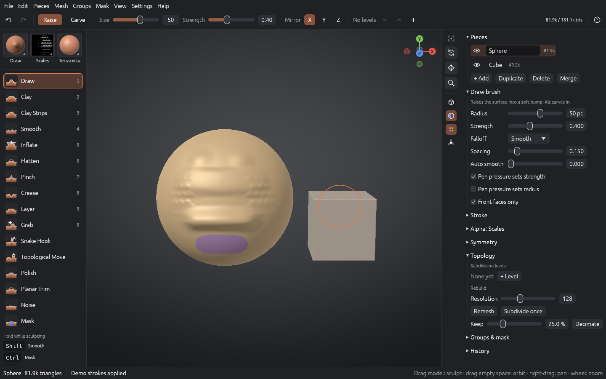

# OxyBrush

**An open-source digital sculpting application written in Rust.**

OxyBrush is for sculptors: concept artists, character artists, miniature and 3D-print makers, and students. The model fills the screen, tools show up when you call for them, and brushes respond immediately even on dense meshes.



> **Status: early development (Phase 2, tech preview).** You can sculpt multi-piece scenes, remesh, decimate, save projects and export today. Expect rough edges, and don't rely on it for production work yet. See the [roadmap](#roadmap).

**Platforms:** Windows 10/11 and Linux (X11 and Wayland) are the supported targets. macOS builds in CI but is best-effort.

## Features (current)

- **12 brushes:** Draw, Clay, Clay Strips, Smooth, Inflate, Flatten, Pinch, Crease, Layer, Grab, Snake Hook, Mask. Each has falloff curves, spacing, auto-smooth and pen-pressure options.
- **Symmetry:** X/Y/Z mirroring plus radial symmetry (up to 64 copies around any axis).
- **Multiple pieces per document:** add, duplicate, mirror-duplicate, delete, rename, show/hide, solo. Alt+click a piece to make it active.
- **Voxel remesh:** rebuilds clean, even topology. "Merge visible" remeshes several pieces into one (a union).
- **Decimation:** quadric edge collapse that keeps open borders and face-group borders.
- **Face groups and hiding:** group visible, group from mask, group by islands, Ctrl+Shift+click to isolate a group, invert visibility, delete hidden, and a group color overlay.
- **Projects:** `.oxb` project files (versioned, checksummed, compressed, saved atomically), a prompt before discarding unsaved changes, **autosave every 2 minutes**, and **crash recovery** on the next launch.
- **Background jobs:** remesh, merge and decimate run on a worker thread, so the UI stays responsive.
- **Chunked mesh engine:** a stroke only re-computes, re-uploads and snapshots the regions it touches.
- **Undo/redo:** covers strokes, topology changes, face groups and visibility, and adding, removing or merging pieces, within a memory budget.
- **Matcap viewport (wgpu):** five procedurally generated materials (no third-party assets).
- **Import/export:** OBJ and STL import (as new pieces). OBJ and binary STL export of all visible pieces (3D-printing ready).
- **Accessibility basics:** UI scaling (75–300%), a high-contrast theme, a full mouse-only workflow, and screen-reader labels through AccessKit.
- **Pure Rust:** no C or C++ toolchain needed on Windows or Linux.

## Performance status

Measured with `cargo run --release -p oxy-sculpt --example dab_timing` on a 4-core cloud VM (CPU only), using a 1.3M-triangle sphere:

| Dab | Time |
|---|---|
| Small (~1k vertices) | ~0.7 ms |
| Large (~15k vertices) | ~2 ms |

Topology (`cargo run --release -p oxy-topo --example topo_timing`, same machine):

| Operation | Time |
|---|---|
| Voxel remesh, 330k triangles in, ~1M out (resolution 320) | ~2.3 s |
| Decimate 1.3M → 130k triangles | ~10 s |

Still to do for 1.0: dab cost at ~100k vertices (target ≤8 ms), faster decimation (batched or parallel collapses), and measurement on the reference hardware.

## Downloads

Test builds for Windows (`.zip`) and Linux (`.tar.gz`) come from the **Release builds** workflow (Actions tab → Release builds → Run workflow). Tagged versions (`v*`) are attached to GitHub Releases.

## Building

You need Rust 1.88 or newer ([rustup](https://rustup.rs)).

```bash
git clone https://github.com/crisprintsstuff/OxyBrush
```

```bash
cd OxyBrush
```

```bash
cargo run --release
```

Open a project or mesh on launch:

```bash
cargo run --release -- path/to/model.oxb
```

**Windows:** install Rust with the MSVC toolchain (the rustup default). The Visual Studio Build Tools "Desktop development with C++" workload provides the linker; no other dependencies are needed.

**Linux packages:** X11 or Wayland development libraries and a Vulkan driver. On Debian or Ubuntu:

```bash
sudo apt install libxkbcommon-x11-0 libwayland-dev mesa-vulkan-drivers
```

**macOS and Windows:** nothing extra (Metal and DX12/Vulkan are used automatically).

## Controls

| Input | Action |
|---|---|
| LMB on model | Sculpt the active piece |
| Alt+LMB on another piece | Make it the active piece |
| Ctrl+Shift+LMB | Isolate the face group under the cursor (on empty space: show all) |
| LMB on empty space | Orbit |
| Alt+LMB on empty space / RMB | Pan |
| Wheel | Zoom |
| Shift / Ctrl / Alt (hold) | Smooth / Mask / Invert |
| `1`–`9`, `0` | Select brush |
| `[` `]` and `-` `=` | Radius and strength |
| `X` | Toggle X symmetry |
| `F` | Frame scene |
| `D` | Subdivide |
| Ctrl+R | Voxel remesh |
| `G` | Face group colors |
| Ctrl+S / Ctrl+O | Save / open project |
| Ctrl+Z, Ctrl+Shift+Z | Undo, redo |
| `F1` | Full shortcut list |

## Architecture

```
crates/
  oxy-mesh     chunked triangle mesh, face groups/visibility, raycast, subdivision  (no GPU)
  oxy-topo     voxel remesh (with unions) and quadric decimation                  (no GPU)
  oxy-doc      scenes of pieces, .oxb project format, autosave/recovery           (no GPU)
  oxy-sculpt   stroke engine, brush kernels, symmetry, falloff                     (no GPU)
  oxy-history  scene-wide undo/redo (chunk snapshots, topology, pieces)           (no GPU)
  oxy-io       OBJ/STL import and export                                           (no GPU)
  oxy-render   wgpu matcap renderer and orbit camera
  oxy-app      winit + egui desktop app (binary: `oxybrush`)
```

Every crate except `oxy-render` and `oxy-app` runs headless and is unit-tested. The full design is in [RFC-0001](docs/rfcs/0001-oxybrush.md).

## Roadmap

| Phase | Goal | State |
|---|---|---|
| 0 | Foundations: workspace, CI, renderer, mesh core | ✅ |
| 1 | Sculpt core: brushes, symmetry, undo, pressure | 🚧 mostly done; Windows Ink / Linux tablet pressure still open |
| 2 | Voxel remesh, decimation, multiple pieces, face groups, `.oxb` project files, autosave | ✅ (first pass) |
| 3 | Quick palette, keymap editor, accessibility audit, installers | ⏳ |
| 4 | Hardening → **1.0** | ⏳ |
| 1.x / 2.x | Multires, dynamic topology, layers, vertex color, plugin API | long-term |
| Research | Read ZBrush `.ZTL` files ([process & rules](docs/formats/zbrush/README.md)) | M0 tooling only; nothing decoded yet |

## Contributing

Everyone is welcome, whether you write code, make art, write docs, translate, or test. Read [CONTRIBUTING.md](CONTRIBUTING.md) first. In particular, every commit needs a DCO sign-off (`git commit -s`), and there is a **clean-room policy**.

## License

Code is dual-licensed under [MIT](LICENSE-MIT) or [Apache-2.0](LICENSE-APACHE), at your option. Bundled assets are CC0.

*OxyBrush is an independent project, not affiliated with any commercial sculpting software vendor. ZBrush is a registered trademark of Maxon Computer GmbH; it is mentioned only to identify a file format OxyBrush aims to interoperate with.*
