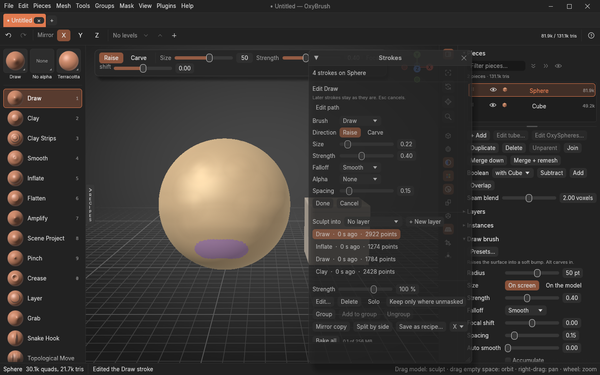
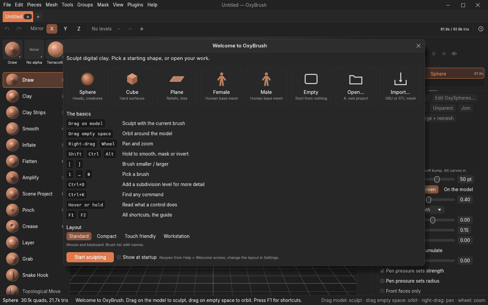
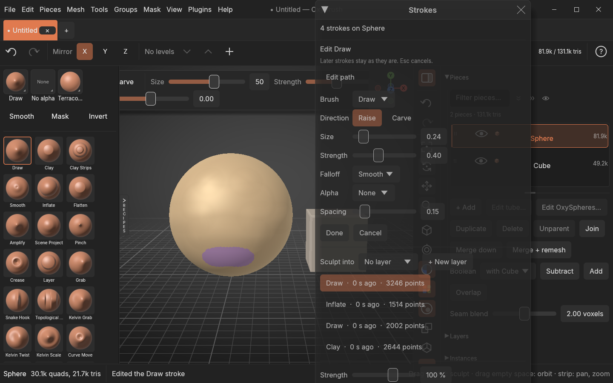
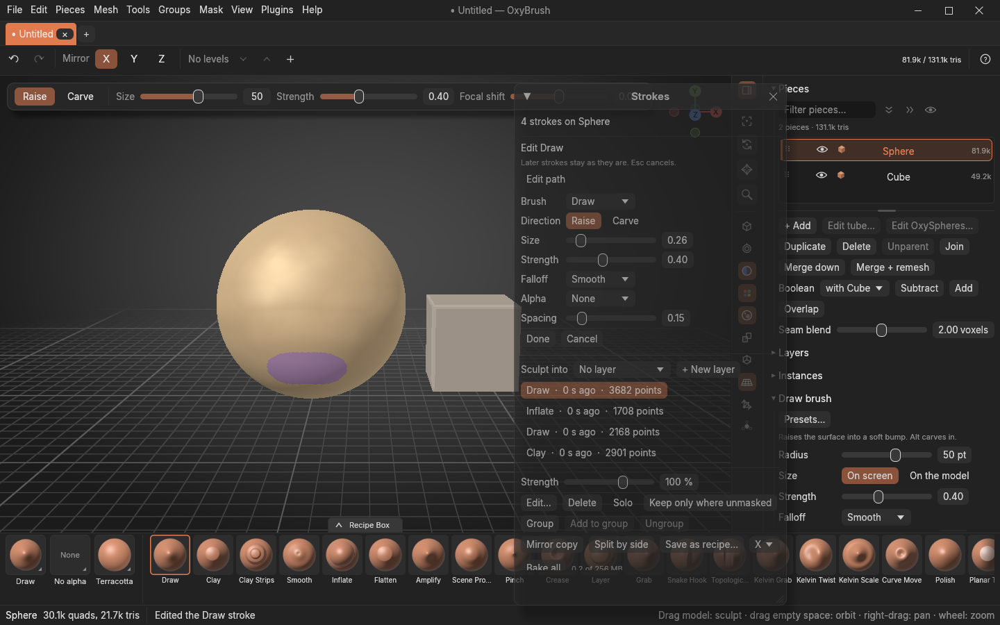

<p align="center">
  
</p>


<p align="center">
  <a href="https://github.com/crisprintsstuff/OxyBrush/releases"></a>
  <a href="https://github.com/crisprintsstuff/OxyBrush/actions/workflows/ci.yml"></a>
  
  <a href="rust-toolchain.toml"></a>
  
  <a href="#license"></a>
  <a href="https://github.com/crisprintsstuff/OxyBrush/releases"></a>
</p>


<p align="center">
  <a href="https://github.com/crisprintsstuff/OxyBrush/releases/tag/v4.1.4"><b>Download</b></a> ·
  <a href="https://github.com/crisprintsstuff/OxyBrush/wiki"><b>Wiki & Docs</b></a> ·
  <a href="https://discord.gg/Vfm7Km7xvG"><b>Discord</b></a> ·
  <a href="docs/TESTING_GUIDE.md">Testing guide</a> ·
  <a href="CHANGELOG.md">Changelog</a> ·
  <a href="docs/ROADMAP.md">Roadmap</a> ·
  <a href="docs/PLANNED_FEATURES.md">Coming next</a> ·
  <a href="https://github.com/crisprintsstuff/OxyBrush/issues/new?template=bug_report.yml">Report a bug</a>
</p>



OxyBrush is a free, open-source sculpting app for concept artists, character artists, miniature and 3D-print makers, and students. You shape 3D models like digital clay. The model fills the screen, tools show up when you call for them, and brushes respond immediately, even on dense meshes.

> **Stable:** OxyBrush **4.1.4** adds quad hands and feet with up to six links per OxySpheres joint, plus an import inspector with undoable face repairs and hole filling. [4.1.4 release notes](docs/releases/v4.1.4.md)

**Highlights**

- **21 sculpting brushes** plus masking, painting, cutting and primitive tools, with stroke stabilizer, editable curve strokes, alphas and pen pressure.
- **Subdivision levels and dynamic detail:** sculpt broad shapes low and fine detail high, or build up a plain sphere as you go.
- **Pieces:** many objects per scene, with voxel remesh, booleans, Join, Split, Symmetrize and decimation.
- **Retopology:** draw a clean quad mesh over a sculpt and project the detail onto it, or use **Edit active mesh** on an existing piece with up to 100,000 editable faces. Contour bridges successive cross-section rings with quads. After subdivision, move points at the displayed level or choose **Keep this level only** before changing connectivity.
- **Poly Edit:** model a low-polygon piece by its faces, edges and points: extrude, inset, bevel, bridge, insert and slide edge loops, close holes, weld points, round picked geometry with **To Circle**, and cut new edges across faces with the **Knife**. Pick with click/paint or **Box** / **Lasso** / **Ellipse** area tools. Area tools select through the piece. Enable **Front only** for visible elements. Close a Knife loop inside a face to create an inset surrounded by quads or larger polygons.
- **3D printing:** real-world size, volume and weight estimates, a wall-thickness check, hollowing with drain holes, and split-with-pins.
- **Vertex color and posing:** paint with masks and symmetry; pose with a mask and the transform gizmo or the Curve Move brush.
- **Your way of working:** four layouts, themes, a full keymap editor, tablet and touch support, and plugins in WebAssembly or Python.
- **Open files:** projects in `.oxb`; import glTF/GLB, OBJ, STL, PLY, FBX and ZBrush `.ztl`/`.zpr` (OBJ, PLY and glTF/GLB with their vertex colors, shown in the viewport over the material; View > Shading > **Show vertex color** hides them); export glTF/GLB (optionally compressed, quantized or meshopt, down to about a quarter of the size: File > glTF compression), OBJ, STL, PLY and 3MF (separate pieces in millimetres for slicers). UVs from OBJ and glTF/GLB are kept through subdivision levels and exported with the active level.

## Download and install

Get **[OxyBrush v4.1.4](https://github.com/crisprintsstuff/OxyBrush/releases/tag/v4.1.4)** or browse [all releases](https://github.com/crisprintsstuff/OxyBrush/releases).

| Platform | File | How |
|---|---|---|
| **macOS 11+** (Apple Silicon and Intel) | `…-macos-universal.dmg` | Open it and drag OxyBrush to Applications. The app isn't notarized yet, so the first launch is blocked: open **System Settings > Privacy & Security** and click **Open Anyway** (macOS 14 or older: right-click the app > **Open**). |
| **Windows 10/11** (64-bit) | `…-windows-x86_64-setup.exe` | Run it. Installs for your user without admin rights; adds a Start-menu entry, an uninstaller and `.oxb` file association. Windows warns about an unknown publisher (not code-signed yet): **More info → Run anyway**. |
| Windows, portable | `…-windows-x86_64-portable.zip` | Unzip and run `oxybrush.exe`. |
| **Linux** (Flatpak) | `…-linux-x86_64.flatpak` | `flatpak install --user OxyBrush-*.flatpak`, then launch from your app menu. Needs the Flathub remote for the runtime. |
| Linux, portable | `…-linux-x86_64.tar.gz` | Unpack and run `./oxybrush`. Needs a Vulkan or OpenGL driver and glibc ≥ 2.35. |

Each release has `SHA256SUMS.txt` for verifying downloads.

## Getting started

On Windows, Intel UHD Graphics 600 devices matching the startup crash in
[#577](https://github.com/crisprintsstuff/OxyBrush/issues/577) use Direct3D 12 by default.
For driver troubleshooting, start OxyBrush with the environment variable `WGPU_BACKEND=dx12` to select Direct3D 12 explicitly.

The first time OxyBrush starts, a welcome window helps you pick a starting shape (sphere, cube, plane, a female or male human base mesh, or an empty scene), open a project or import a mesh, and choose a layout. **File > Close project** brings it back, after asking to save unsaved work, and **File > Revert** reloads the project as you last saved it. Hover over any brush or control for a short explanation and its shortcut; on a touch screen, press and hold it.



1. **Orbit** by dragging on empty space, **zoom** with the wheel, **pan** with the right mouse button. **F** frames the model. Orbiting turns around the point of the model under the pointer where you start it (from empty space, the nearest part of the model), which stays put on screen, so you can turn around any spot you point at. Preferences > **Orbit around** can make it the last stroke or the centre of the view instead.
2. **Sculpt** by dragging on the model. Pick brushes with **1–9, 0** or the brush shelf; hold **Shift** to smooth, **Ctrl** to mask, **Alt** to invert; **[** / **]** resize the brush.
3. **Need more detail?** **Ctrl+D** adds a subdivision level (quads, keeping your edge loops), and **D** / **Shift+D** step between levels, keeping your detail. **Ctrl+R** remeshes to even triangles.
4. **Save** with **Ctrl+S** (an `.oxb` project). **Ctrl+E** exports glTF/GLB, OBJ, STL, PLY or 3MF for game engines, other 3D apps or 3D printing.
5. **Find anything:** **Ctrl+K** finds any command by typing part of its name, **Space** finds a brush, **F1** lists every shortcut and **F2** opens the built-in guide (searchable, works offline). **Ctrl+,** opens Preferences.

### Make it yours

**Layouts** (Preferences > General, or in the welcome window):

| Layout | For |
|---|---|
| **Standard** | Mouse and keyboard: brush list with names and icons |
| **Compact** | Small screens: tighter spacing and an icon-only brush grid |
| **Touch friendly** | Touch screens and pen tablets: large buttons, a brush tile grid, on-screen **Smooth / Mask / Invert** toggles instead of modifier keys, and undo/redo beside the viewport |
| **Workstation** | Dense layout: a two-column brush shelf and the main controls in the top bar |



- **Arrange the panels** (Preferences > General, or right-click the brush shelf or the size/strength bar): put the brush shelf left, bottom or right; the settings panel left or right; and size, strength, focal shift and Raise/Carve floating at the top or bottom of the viewport, or in the toolbar. **Drag brushes** in the shelf to reorder them; the number keys follow your order. **Right-click a brush > Set hotkey** gives it a key of its own.
- **Fit more in the shelf:** turn off **Show brush names** (Preferences > Interface) for an icon grid, or use **Narrow brush shelf** for a single column.
- **Mask and selection shapes** appear in two short columns on the bottom brush shelf while you hold **Ctrl** or **Ctrl+Shift**.
- **Change the look** in **Preferences > Appearance**: themes (including Sculptor and Midnight), a **Mix** that takes the colors, the controls (sliders and tiles) and the shadows each from any theme, accent and button colors, brush icon colors, UI tint hue and intensity, chrome brightness, the viewport background, interface scale, corners and slider thickness.



OxyBrush remembers your window, layout, arrangement, brush order, theme, material and other preferences between sessions. Turn on **Remember brush settings between sessions** (Preferences > General) to keep the current brush and every brush's own settings too. **Lighter inactive pieces** (same place) shows pieces with subdivision levels at a lower level while you work on another, to save memory on big scenes.

### Working with other apps

- **Blender:** Send selected mesh objects to the running OxyBrush window and sculpt them upright. Send Back converts them to Blender’s axes. See the [Blender bridge installation and workflow](integrations/blender/README.md).
- **OxyCharacter:** OxyCharacter opens its character in OxyBrush as a project with a `character.oxb.oxylink.json` file next to it. OxyBrush shows **Linked to OxyCharacter** in the top bar; sculpt, add pieces, then click it (or **File > Send back to OxyCharacter**) to send the result back. Sculpted changes to `OxyCharacter Body` return as a morph and new pieces as accessories. To keep the body a morph, use subdivision levels rather than operations that change its topology (remesh, decimate, Boolean, split, delete hidden); OxyBrush warns you once if you do.
- **An AI agent on your computer** (off unless you turn it on): **Preferences > AI agent** lets a program on this computer sculpt in the same scene as you. It listens only on this machine, shows **Agent connected** while one is here, and its edits undo like yours. Setup for common agents is in [docs/mcp.md](docs/mcp.md).

## Help test OxyBrush

Testers are the most useful contribution right now, especially with **pen tablets**, **varied GPUs** and **3D printing workflows**.

1. Follow the [testing guide](docs/TESTING_GUIDE.md) (about 20 minutes).
2. Report problems with **Help > Report a bug…** in the app. It opens a GitHub issue form with your version, OS and GPU filled in. Attach the log from **Help > Open log folder**.
3. See what's coming in [Coming next](docs/PLANNED_FEATURES.md) and tell us what you'd want first.
4. Share impressions with **Help > Send feedback…**, or chat with other testers on [Discord](https://discord.gg/Vfm7Km7xvG): what felt good, what was frustrating, what you missed.

## Features

### Sculpting

- **21 sculpting brushes, plus 8 tools in the same shelf:**
  - **Shape:** Draw, Clay, Clay Strips, Smooth, Inflate, Flatten, Amplify (exaggerates existing bumps and recesses; Alt reduces that contrast), Scene Project (projects onto other visible pieces; Alt along the surface normal; large Stamp previews update in the background), Pinch, Crease (with a Pinch setting for how tight the groove is), Sharp Crease (a crisp V along the stroke, for hard folds and panel lines), Layer, Polish, Planar Trim, Noise.
  - **Move:** Grab, Snake Hook, Topological Move, Curve Move, and the elastic brushes Kelvin Grab, Kelvin Twist (drag sideways), and Kelvin Scale (drag vertically). Kelvin Grab localizes short pulls and broadens the response as the drag grows. Alt constrains Kelvin Grab to the surface normal and reverses Kelvin Twist or Kelvin Scale.
  - **Tools:** Mask, Paint (vertex color), Paint Groups (face groups), Insert Primitives (sphere, quad sphere, UV sphere, cube, cylinder, cone, torus or plane that grows as you drag), Tube, and the cutting tools Plane Clip, Line Split and Cut Away (straight Line, multi-point Curve, rectangle, lasso, circle or ellipse cutters, with Alt to choose the other side), which follow symmetry. Plane Clip moves vertices to the drawn Curve or closed outline at their original view depth.

  Each sculpting brush has falloff curves, spacing, auto-smooth and pen-pressure options. **Shift** smooths, and holding it while dragging changes the smoothing strength on the fly. Smoothing follows the polygon edges on OBJ, modern FBX, and linked Blender meshes that retain their quads or n-gons.
- **Strokes:** a stabilizer for smooth lines, Freehand, Line, Stamp and **Curve** stroke modes, spray, and pressure curves for strength and size. In **Stroke**, customize either curve for the current brush or use the defaults from **Preferences > Pen & tablet**. **Each brush keeps its own settings**, alpha included (size stays shared unless **Size per brush** is on; Preferences > General). A Curve stroke stays editable after you draw it: drag, add or remove points, change size and strength per point, close it into a loop, and see the result live before you Accept ([RFC 0004](docs/rfcs/0004-curve-stroke.md)). **Stamp** grows one stamp under the pointer as you drag (size and rotation), at the same strength as a short freehand stroke. In Freehand mode, hold still mid-stroke to turn it into a curve. **Edit > Last stroke** can Replay that Freehand stroke in place, reopen it as an editable curve, or use its path for a Curve Move curve or a tube.
- **Living strokes** (an option, off by default; the **Layers** section of the right panel, with **Strokes…** for the full list): every stroke stays editable. Fade a past stroke from 0 to 150%, delete it, take away the part of it you've masked, or see it on its own, without undoing what you did after it. **Edit…** (or double-click a stroke) changes its brush, Raise or Carve, size, strength, falloff, alpha or spacing, and the stroke is sculpted again; later strokes stay as they were. Esc cancels the edit. Put strokes in named **groups** to use them like sculpt layers, each with its own strength and show/hide box, or pick a layer with **Sculpt into** before you sculpt or pose unmasked geometry with the gizmo. Each change is an undo step, and strokes are saved with the project ([RFC 0017](docs/rfcs/0017-living-strokes.md), [RFC 0025](docs/rfcs/0025-editable-and-portable-strokes.md)). Sculpt and paint layers keep their strength and visibility controls when you switch or add subdivision levels. Remeshing bakes the strokes into the surface. Mirror copy puts a stroke on the other side, Split by side splits a symmetric one, and glTF/GLB exports carry each group as a shape key. Plugins and agents can read and edit strokes and groups too.
- **Deform window** (Tools > Deform…): whole-piece deformers that respect the mask: move, rotate, scale, bend, S-bend, skew, S-skew, three kinds of flatten, twist, taper, squeeze, perspective and sag; noise, inflate and spherize; and smooth, polish (plain, keeping detail, group edges or sharp edges) and relax. Drag a bar to see the result live and let go to apply it (on very large pieces the model catches up in the background while the bar follows the pointer, and a quick flick still applies); repeat it on this piece or on all others. Also Fit to standard size, Mirror and Symmetrize ([RFC 0016](docs/rfcs/0016-deform-window.md)).
- **Surface Noise** (Tools > Surface Noise…): displace the whole piece along its normals with procedural noise — scale, strength, octaves, seed, and Smooth / Turbulent / Cellular patterns. Preview updates live; Apply bakes one undo step. Masked parts stay put unless Use mask is off ([RFC 0045](docs/rfcs/0045-surface-noise.md)).
- **Scale cover** (Tools > Scale cover…, “Dino mode”): place overlapping scale plates on the active piece with surface instances — built-in teardrop, diamond, round, plate, ridge and spike, or any piece as the source; scatter, mask or face-group placement. Edit source and Make real as with Instances ([RFC 0046](docs/rfcs/0046-scale-cover.md)).
- **OxyMorph** (Tools > OxyMorph): fork an editable B variant from the active piece A. Sculpt B, then choose **Preview mix** and adjust the blend. Paint **Keep A** or **Keep B** on the preview to retain parts of either sculpt. **Erase** returns those areas to the mix slider. Turn on **Show paint map** to see A in blue and B in orange. **Create piece from mix** adds a new sculptable result with one Undo step. The tool works on matching topology up to 200,000 triangles at the displayed level. [RFC 0056](docs/rfcs/0056-sculpt-variants.md)
- **Curve Move:** draw a curve along an arm or a tail, then drag its points. The part bends and stretches to follow, like a simple rig; masks protect what shouldn't move, and symmetry moves both sides ([RFC 0005](docs/rfcs/0005-curve-move.md)).
- **OxySpheres:** block out a figure or creature with a tree of spheres (Pieces > + Add > OxySpheres…), then make it one smooth mesh to sculpt ([RFC 0034](docs/rfcs/0034-oxyspheres.md)). Drag from a sphere to pull out a new one, Shift+drag to move one, Ctrl+drag to resize it, click a link to add a sphere on it, and Alt+click or Delete to remove one with the spheres below it. Mirror across X keeps both sides in step. **Resolution** and **Blend** set how fine the mesh is and how round the joins are. The spheres are a piece of their own: **Make mesh** (Enter) adds a new piece made from them and keeps them, so you can change them and make another mesh any time (it updates the last piece it generated, even after you save and reopen, while that piece is unchanged, and adds a new one after you edit it); Voxel skin makes thin limbs finer automatically. **Keep spheres** saves them without making a mesh. Click the spheres piece (or Pieces > Edit OxySpheres…) to open it again.
  In **Rotate** mode, drag left or right from a sphere or link to pose the entire branch around its parent. Choose **Link** as the axis to twist along the branch, or choose View, X, Y, or Z to turn it. The root rotates around its center, and mirrored branches move as a pair.
  Choose **Output > Quad base mesh** for an experimental low-density mesh with edge loops along chains and through joints with up to six links. Connect an incoming forearm or ankle and five fingers or toes to one joint. **Resolution** adds rings on long links; **Blend** softens the joins; **Subdivision** (0–2) smooths the cage when you Make mesh. Projects remember the quad output and level. Crowded three-way joints can use narrower sockets while keeping the armature intact. The preview shows the spheres in this mode. If **Make mesh** reports an unsupported arrangement in the OxySpheres window, adjust the spheres or choose **Voxel skin**. To inspect the cage with smooth viewport shading, set **View > Shading > Hard edge angle** to 180° and turn off **Flat shading**.
- **Tubes:** drag a path from the model or empty space to get a tube along it, shape its points and thickness, double-click a point for a **sharp corner**, merge or delete points, give it any **cross-section** (draw it in the Profile editor, or start from a square, triangle, star, D-shape or ribbon, with smooth or sharp corners point by point), and edit it again later ([RFC 0009](docs/rfcs/0009-tube-tool.md)). **Twist** turns it along its length, **Spin** coils it around the path like a spring (coil size and turns), and **Braid** makes three round strands woven along the path, from tight to loose (**Spread**) with as many weaves as you like (**Turn**).
- **Alphas:** grayscale images shape each dab: eleven built-in procedural alphas (overlapping **Scales**, **Snake scales**, **Diamond scales**, **Scale plate**, tileable **Scale strip**, and the older Noise/Bumps/…) plus your own images, with a live rotation preview, follow-stroke, **Tile**, **Roll** (path-length scroll along the stroke) and rotate jitter. **Load image…** imports PNG, JPEG, TIFF, WebP or a PSD composite into the alpha library for any project, including after a restart. **Capture from view** turns what the viewport shows into an alpha (up to 4096 px) with antialiased silhouettes, saved with the project; **Export alpha…** saves one as a 16-bit PNG to edit in a 2D app.
- **Accumulate** in brush settings controls whether overlapping dabs build on one another in Draw, Inflate, Clay, and Clay Strips. It starts **on** for those brushes (and Soft clay buildup). With it off, buildup is capped at the strongest dab per point until you lift the brush (flat-topped strokes).
- **Gravity:** give any brush a Gravity setting (each brush keeps its own) and the surface sags downward as you sculpt, for drapery and hanging folds.
- **Brush presets:** save any brush (kind, size, strength, falloff, stroke, alpha, gravity) as a preset, and share it as a one-line code (`oxyb1:…`) or an `.oxbrush` file. Five starter presets are included.
- **Symmetry:** X, Y and Z mirroring that blends smoothly across the middle, plus radial symmetry (up to 64 copies around any axis). Each piece mirrors about its own centre, chosen from its shape when it's opened, with **Recentre** and **World origin** buttons to change it.
- **Quick menu at the cursor:** right-click or hold **Q** on the viewport for Raise/Carve, size, strength and the brush's own settings.

### Detail and topology

- **Subdivision levels:** add levels, sculpt broad shapes on a low level and fine detail on a high one; edits on a low level carry the higher-level detail along. For more resolution in one area only, mask it and use **Subdivide masked** (Mask and Mesh menus; step by step in [Adding detail to one part of a model](docs/guides/detail-on-one-part.md)). Levels are **quads** by default (Catmull–Clark, so a quad base mesh keeps its edge loops and exports as quads at every level, with Poly Edit creases kept sharp), or triangles (Loop) if you choose ([RFC 0019](docs/rfcs/0019-quad-subdivision.md)). Turn **Smooth** off to split faces without rounding the shape (linear subdivision), per level. **Rebuild lower level** recovers another Catmull–Clark level beneath the base of a compatible closed quad mesh or stack, keeping the viewed level and sculpted detail ([RFC 0036](docs/rfcs/0036-rebuild-lower-subdivision-level.md)). Levels are saved in the project and covered by undo, with a configurable triangle limit (`max_triangles`).
- **Smooth preview:** in Topology (and in Poly Edit), show the Catmull–Clark smooth surface of a low-polygon cage without applying it yet; **Subdivide (smooth)** bakes it when ready ([RFC 0048](docs/rfcs/0048-dynamic-smooth.md)).
- **Favorites:** star brushes for a Favorites strip on the shelf; star, rename and duplicate presets; find `Preset: …` in Ctrl+K / Space ([RFC 0049](docs/rfcs/0049-custom-brush-shelves.md)).
- **Edge loop at mask border** (Mask and Mesh menus): adds support loops along the edge of the mask, on one or both sides, at a width you choose, in a face group of their own, so a hard edge stays crisp when you subdivide or smooth. **Group the masked area** (on by default) also gives the triangles inside the mask a face group, so that area can be isolated; the outside keeps its groups and hidden faces stay out. Mask a face group (Ctrl+M) to put the loop exactly around it.
- **Dynamic detail:** turn it on in the Topology section and brushes add triangles where they need more detail and remove ones that became too small, so you can build a shape from a plain sphere without remeshing. Works best up to a few hundred thousand triangles ([RFC 0006](docs/rfcs/0006-dynamic-detail.md)). It is off on pieces with subdivision levels; **Keep this level only** turns the level you see into the piece's mesh so it works again.
- **Voxel remesh:** rebuilds a piece with even triangles, on a sparse voxel grid that reaches 1024+ voxels across with little memory. Parts that overlap, or a surface sculpted through itself, come out as one solid, and holes are patched first. **Shell** makes a wall of a chosen thickness instead (outward, both sides or inward): a sheet gets a thickness, a closed model comes out hollow. An **Adaptivity** slider uses fewer triangles on flat areas, and quad output exports as quads in OBJ. Topology **Show remesh density** draws a preview grid of the current voxel / OxyRemesh cell size on the active piece before you rebuild ([RFC 0050](docs/rfcs/0050-remesh-density-preview.md)).
- **OxyRemesh:** Mesh > OxyRemesh rebuilds the active piece as a lighter pure-quad mesh with edges that follow the surface (field-aligned remesh from Instant Meshes research, pure Rust). Carries paint, mask and face groups. Adaptivity / anisotropy, optional guide from the last freehand stroke, and optional poles toward the mask. Runs in the background; one undo. The fitted-chart path uses isolines when it passes coverage and topology checks. Closed inputs require closed output, with a voxel fallback if the field extraction cannot close. Manual Retopology (below) is still available when you want to draw quads by hand ([RFC 0044](docs/rfcs/0044-auto-retopology.md)).
- **Project detail:** Mesh > Project detail (also Rebuild and the command palette) moves every vertex of the active piece onto the closest point of the other visible pieces, so a clean remesh or cage picks up a high-detail sculpt without changing its triangles. Mesh > Project onto… picks one source. Runs in the background; one undo ([RFC 0051](docs/rfcs/0051-detail-reproject.md), [#516](https://github.com/crisprintsstuff/OxyBrush/issues/516)).
- **Recipe Box:** View > Recipe Box opens a movable window of reusable sculpted details (close with ×; remembered). Drag a recipe onto a model; click a slot to rename it, assign a category, choose a variation, or change its order.
- **Surface instances** (the right panel's **Instances** section): copy a piece onto faces, points, a face group, or the masked surface, or scatter copies with a minimum spacing. Copies follow the surface as you sculpt. **Edit source** changes all of them at once; choose which way they face, their size, lift and random variation; **Make real** turns them into ordinary mesh ([RFC 0022](docs/rfcs/0022-surface-instances.md)).
- **Booleans** (the Pieces panel's Boolean row, or Mesh > Boolean): subtract another piece from the active one, add it, or keep only the overlap, on voxel volumes, robust to self-intersecting or non-manifold input. **Seam blend** rounds the seam over a few voxels so it comes out smooth, and the rest of the piece keeps its shape.
- **Decimate:** reduces triangles while keeping the shape, open borders, face-group borders and vertex color (1.3M → 131k triangles in about 0.7 s on 4 cores).
- **Symmetrize** (Tools > Symmetrize): makes a piece symmetric after the fact. It keeps one half, replaces the other with its mirror image and welds the seam (any axis, either side).
- **Retopology** (Tools > Retopology): draw a clean quad mesh over a sculpt. Click to place points on the surface, Shift+click to make quads, Tab+drag a border edge to extend, Ctrl+click an edge to add a loop, Shift+drag to relax (Alt+click pins points so relax leaves them). For limbs, turn on **Contour** and drag two cuts to bridge their rings with quads. Use **New strip** to start another set. The result is a new piece that exports as quads; **Subdivide and project** gives it levels that carry the sculpt's detail ([RFC 0012](docs/rfcs/0012-retopology.md)).
- **Poly Edit** (Tools > Poly Edit, [RFC 0018](docs/rfcs/0018-poly-edit.md), first steps): model a low-polygon piece (a primitive, a retopology mesh, anything up to 400,000 triangles) by pointing at a face, an edge or a point; what its action would change lights up. Each kind has its own action, so there is no mode to switch. **Faces:** drag to **extrude** or **inset**, drag to **move** along the normal, click to **delete**; **Reach** spreads it to the face loop, the face group, the flat region or the island. Press **1**, **2**, **3** to work on **faces**, **edges** or **points** (or **4** for Auto, where what's under the pointer decides); the window then shows only those actions. Ctrl/Cmd+click picks several of them to act on at once (Ctrl/Cmd+drag paints the pick, or unpaints it when started on a picked one; Ctrl/Cmd+double-click: a whole edge or face loop; Esc clears the pick), and the pick turns into the new kind when you switch ([RFC 0023](docs/rfcs/0023-poly-edit-element-modes.md)). The **transform gizmo** (T) works on what's picked: move, turn or scale it, and **Shift+drag** to extrude faces or border edges first (or inset faces, on a scale handle). **Soft selection** moves the points around the pick too, fading with distance, for smooth bulges. The Faces, Edges, Points and Auto buttons are also at the top of the brush shelf. **Edges:** click to **insert an edge loop** (drag to slide it, Shift+click for the middle, or **Two loops** for a pair even from both ends), **dissolve** edges or a whole loop to merge adjacent faces, **delete** edges to remove their incident faces, drag a border edge to **extrude** it, click one to **close the hole**, or **bridge** two border edges with a quad by clicking one of each (picked rows of edges make a strip, two picked hole borders a tube). **Points:** drag to **move** one (drop it on another to **weld** them), or **delete** it. Mirror across X does the other side too. Each change is one undo step; Escape cancels a drag. Polygons with more than four corners are kept and saved. **Shaping:** **bevel** faces (a chamfered extrude) or edges (with corner faces where three meet), flat or rounded over several rows, **bridge** two faces with a tube (rows and twist), **slide** an edge or loop along its neighbours, **spin** an edge, **split** a face between two points, and **equalize** the spacing of points along the surface. **Y** repeats the last action, with the same amount, on what's under the pointer. **Smooth:** crease edges or points (with a weight), preview the smooth subdivided surface live under the polygons, then **Subdivide (smooth)** to keep modeling on it or **Smooth and sculpt** to hand it to the brushes (Catmull–Clark with semi-sharp creases).
- **Mesh repair:** Close holes, Delete hidden, and a Topology diagnostics window (Mesh > Topology diagnostics…) that finds open edges, non-manifold edges and degenerate triangles.
- **Import inspection.** When an imported piece has topology findings, **Inspect import** in the status bar lists the affected pieces, open and non-manifold edges, inconsistent winding, duplicate triangles, and zero-area faces. The report describes the mesh at import or after the latest repair. Open edges can be intentional on a sheet. Use **Repair faces** to remove duplicates and zero-area triangles and correct winding. Choose **Close holes** separately to fill open boundaries on a suitable piece. Each action updates the report and has one Undo step.

### Pieces, masks and groups

- **Pieces:** many meshes per scene: add (parametric sphere, with even quads, UV rings or triangles; cube, plane, cylinder, cone, torus, and a **disc**: a flat round plate, a ring with a hole or a slice of either, made of quads), duplicate and mirror-duplicate (with every subdivision level), **linked copies** (plain or mirrored: they follow the original as you sculpt it; move them with the gizmo, Unlink to free one), delete, rename, show/hide, solo; Alt+click a piece to make it active. In the Pieces menu, **Mirror duplicate** and **Mirror duplicate linked** each offer X, Y and Z. **Join** combines the visible pieces exactly as they are (each keeps its face groups), and **Merge down** the active piece with the one below it; Ctrl/Cmd+click pieces in the list to move, turn and scale them together with the transform gizmo; **Merge + remesh** fuses them into one closed surface. Split a piece by face groups, into loose parts, by its hidden faces or by its mask (**Split masked**). Right-click a piece for its hierarchy: **Select**, **Join** or **Merge hierarchy** (the piece and everything under it).
- **Masking and selection:** paint a mask with Ctrl, or box or lasso it (following symmetry); mask by cavity, peaks or face group, or mask the border of the visible surface or the lines where face groups meet; blur, sharpen, grow, shrink or invert it. **Extract mask…** turns the masked area into a shell piece with live preview of its thickness.
- **Face groups and hiding:** the **Paint Groups** brush (each stroke a new group; Alt grows the one you start on; Shift smooths jagged group borders), group visible, group from mask, group by islands, Ctrl+Shift+click to isolate a group (Ctrl+Shift+Alt+click to hide it), invert visibility, and a group color overlay.
- **Transform gizmo (T):** move, rotate or scale a piece. With a mask, only the unmasked part moves and a soft mask edge bends smoothly, which makes it a quick posing tool. It snaps with Shift and has pivot choices (the pivot follows the mask edge by default; untick **Follow the mask** to keep it in place) and operators (mirror, put on the ground, centre at origin). Its fields show the move, turn or scale live while you drag; type a value and press Enter to land exactly on it. A second row shows the actual **size** and **centre** of what it moves (along the world axes), also live; type a size or a position to set it exactly (with Even on, the other sides follow in proportion). **Apply** keeps the changes and counts from zero again; **Cancel** puts them back (Redo brings them back); **Done** closes the gizmo and keeps them, unless Preferences > General > *Closing the gizmo puts back changes not applied* is on.

### Color and viewport

- **Split view:** View > Split view shows two viewports side by side or stacked, each with its own camera. Click a pane to sculpt or orbit there; drag the divider to resize ([RFC 0054](docs/rfcs/0054-split-view.md)).
- **Vertex color:** a Paint brush (Shift blends vertex colors; Alt erases; works with alphas and symmetry). Strength sets how opaque each stroke is, without overlapping dabs stacking past that value. Open **Color Jitter** in the Paint settings to vary hue, saturation, and value per stroke or per dab. Sculpt brushes can turn on **Also paint** to lay that color under each dab while they move the surface. **RGB Strength** sets the color opacity independently ([RFC 0052](docs/rfcs/0052-also-paint.md)). There are also fills for the whole piece, its cavities or its peaks, all respecting the mask. **Color Filter…** (Tools > Vertex color) adjusts Fill, Hue, Saturation, Value, Brightness, Contrast, Smooth and RGB across the piece with live drag bars. Color is kept through subdivision, remesh, booleans and decimate, and exported in glTF/GLB, PLY and OBJ.
- **Materials:** six built-in matcaps, or load your own (PNG or JPEG), previewed live as you hover. Give a piece **its own material** (For: *piece* only, in the material picker) to tell parts apart; it's saved with the project. **Ambient occlusion and cavity shading** make folds and pores read clearly; **flat shading** shows every polygon. **Hard edge angle** (View > Shading) sets how sharp a corner must be before those faces shade flat (40° by default; 180°, shown as Off, keeps every edge smooth). It only changes the view and is remembered.
- **Pieces:** focus a row and press Up or Down to step through the list. **Show Only** follows the active piece and restores the prior visibility when switched off. The Keymap editor can bind **Grow visible** and **Shrink visible**.
- **Grid:** the viewport grid faces the camera in snapped front, side, and top orthographic views.
- **X-ray:** click the X-ray button on the viewport toolbar or open **View > X-ray**. Right-click the toolbar button to change mesh opacity or fade only the active piece, inactive pieces, or all visible pieces. The scope defaults to inactive pieces and is remembered across launches. Sculpting, selection and retopology still pick the same mesh surfaces.
- **Reference images:** open **View > References** to import a PNG or JPEG. Choose Front, Back, Right, Left, Top, or Bottom, preview the position, width, opacity, quarter-turns, and flips as you adjust them, then click Apply. Use the matching view button to line up the image. Enable X-ray to see an image through the sculpt, or choose Draw over mesh. Use **Align to landmarks** to match two image points to two sculpt points. Review the fit and repick any landmark before choosing **Use fit**. The project embeds the images and their placements.
- **Selection shapes:** hold Ctrl or Ctrl+Shift to pick rectangle, lasso, circle, ellipse, or curve beside the brush shelf. With Plane Clip, Line Split or Cut Away selected, the same row selects the cutter shape and adds a straight Line option. L also cycles through the shapes.
- **Lights and shadows:** switch the viewport to up to four lights (sun, point, spot or **area**) with soft shadows, in **View > Shading > Light the viewport** and **Lights…** ([RFC 0008](docs/rfcs/0008-viewport-lights.md)). An **area** light has a size: its shadows are sharp where things touch and softer further away. With viewport lights on, **Materials > Lit surface** lets you choose **Matcap** or a scene-wide **Custom** color and adjust roughness and specular. Picking a matcap switches the lit surface to Matcap. In the **Lights** window, **Softness** makes each light fade gently where the surface turns away ([RFC 0024](docs/rfcs/0024-area-lights-and-lit-matcap.md)).
- **Wireframe and floor grid:** a wireframe overlay (Shift+W) in a color of your choice, and a floor grid that follows the model's size and position.
- **Inactive pieces** (View > Inactive pieces): greyed out, darkened, tinted with a color you choose, or shown in their true materials.
- **Camera:** a focal length from 15 to 200 mm (35 mm equivalent), orthographic view, numpad side views, and an axis gizmo you click to snap to a side or drag to orbit.

### 3D printing

**Mesh > 3D print…** shows real-world size in millimetres, surface area and volume, checks that the mesh is closed, and estimates resin and filament weight. It also has:
- **Wall thickness:** finds walls that are too thin and paints them red/orange on the model.
- **Hollowing:** hollows a piece with a chosen wall thickness and adds drain holes.
- **Split for printing:** cuts a piece along X, Y or Z into parts with registration pins and matching sockets (0.2 mm clearance).

### Input and tablets

- **Pen pressure** for graphics tablets (Wacom, Huion, XP-Pen and others; Windows Ink; Linux X11 and Wayland), with adjustable pressure curves for strength and size, presets and a live readout in **Preferences > Pen & tablet**. The pen's side button works too.
- **Pen gestures:** drag with the pen in a panel to scroll it, and hold the pen still on a control to open its menu or read its tip. The **Pen side buttons** navigation preset orbits and pans with the side buttons ([RFC 0015](docs/rfcs/0015-pen-gestures.md)).
- **Touch:** pinch to zoom, two-finger orbit and pan, and two-finger tap to undo; trackpad pinch and rotate.
- **Keymap editor** (Preferences > Keymap): rebind every command, brush, view key and mouse button, with conflict warnings. Navigation presets: **OxyBrush**, **MMB orbit**, **Right-drag orbit** and **Pen side buttons**; shortcut presets **Default** and **Single-key tools**.

### Files and pipeline

- **Projects & tabs:** work across multiple open `.oxb` projects in **tabs** (session restore on launch can be toggled in **Preferences > General**), with **Copy piece / Paste piece** (`Ctrl+C` / `Ctrl+V`) across tabs including living strokes. `.oxb` files are versioned, checksummed, compressed and saved safely (a crash mid-save never damages the old file). Open one by double-clicking it or dropping it on the window. **Per-tab autosave** every 2 minutes (adjustable) and **multi-tab crash recovery** on the next launch.
- **UVs** from OBJ and glTF files are kept per face corner through sculpting, saving and export (OBJ, glTF/GLB), so a model can go on to texturing or baking; rebuilding the triangles (remesh, dynamic detail, subdivision levels for now) drops them, with a note.
- **Import:** glTF (`.glb`, `.gltf`; each mesh in the scene becomes a piece where the scene places it, including meshopt- and quantization-compressed files; not Draco), OBJ, STL, PLY and Autodesk FBX (`.fbx`; both 7.x binary/ASCII and legacy 5.8/6.x ASCII/binary, with transforms, UVs and material face groups preserved; each mesh becomes its own piece; broken material files don't stop an import). The Import dialog and a drop onto the window can take several files at once (Shift-click or Ctrl/Cmd-click): each file's objects become pieces, in one undo step, in name order, and a file that can't be read is skipped and named. Vertex colors come in too: OBJ colors after each vertex (`v x y z r g b`, 0–1 or 0–255) or in `#MRGB` comment blocks, and PLY `red green blue`; and ZBrush `.ztl` and `.zpr` files (each object becomes a piece, its groups become face groups). An import far larger or smaller than the scene, such as one in millimetres, is scaled to fit; several files imported together share that one factor so their relative sizes stay. One Undo keeps the original size.
- **Export:** all visible pieces to glTF 2.0 (`.glb`/`.gltf`), OBJ, binary STL, binary PLY or 3MF (`.3mf`, millimetres from the scene unit size), one object per piece.
- **Pipeline helpers:** make an LOD chain (1/2, 1/4 and 1/8 of the triangles), and the `oxybrush-cli` command-line tool for batch conversion, remeshing, decimation, LODs and splitting.

### Interface

- **Menus:** File, Edit, Pieces, Mesh (resolution and repair), Tools (Deform, Surface Noise, Scale cover, Transform, Symmetrize, Poly Edit, Retopology, vertex color), Groups, Mask, View, Plugins and Help, a toolbar with Raise/Carve, size, strength, symmetry and subdivision levels, and a view strip beside the viewport with a button that hides the settings panel and toggles for the mask, face groups, shading, wireframe and floor grid.
- **Command palette (Ctrl+K)** for any command, brush, recent file or guide topic; a **brush finder (Space)**; and a searchable **offline guide (F2)**.
- **Accessibility:** interface scale from 75 to 300%, a high-contrast theme, a full mouse-only workflow, and screen-reader labels.
- **Undo/redo** covers strokes, topology changes, face groups, visibility and pieces, within a memory budget. **Undo on this piece** (Ctrl+Alt+Z) takes back the active piece's last change even if you changed other pieces since; turn on **Preferences > General > Undo works on the active piece** to make that what Ctrl+Z does. The History section can show just the active piece's changes.
- **Optional updates:** off by default. **Preferences > Updates** can tell you about new versions or download them in the background; installing always waits for you, and downloads are checksum-verified. Only GitHub is contacted, and nothing about you or your work is sent ([details](docs/rfcs/0002-updates.md)). Flatpak installs update through Flatpak.

### Plugins

- **Built-in plugins** in the **Plugins** menu, nothing to install: Displace, Mask by Height, Color Ramp, Array, Measure, Group by Height, Group by Angle, Hide Faces by Angle, Color by Group, Fill Holes, Simplify Mesh, Flip Faces and Squash. Some preview their result live before you Accept, long ones can be stopped, and their settings are remembered.
- **Your own plugins:** WebAssembly plugins run sandboxed inside OxyBrush, written in Rust, WebAssembly text or any language that compiles to WebAssembly. **Plugins > Install add-on…** adds an `.oxyaddon`. See the [plugin guide](docs/plugins/README.md) and [API reference](docs/plugins/api-reference.md).
- **Python scripts:** a zero-dependency Python SDK (`python/oxybrush`) talks to OxyBrush over the local AI-agent connection to inspect the scene, run strokes, remesh and more. Scripts can patch selected vertices, group repeated writes in one Undo step, read lights and show temporary rendered images in the single viewport with the [MCP geometry and viewport tools](docs/rfcs/0053-mcp-geometry-write.md). Run a script with **File > Run Python script…** or manage scripts in **Preferences > Plugins**; examples are in `examples/plugins/`.

## Controls

| Input | Action |
|---|---|
| LMB on model | Sculpt the active piece |
| Alt+LMB on another piece | Make it the active piece |
| Ctrl+Shift+LMB | Isolate the face group under the cursor (on empty space: show all) |
| LMB on empty space | Orbit |
| Alt+LMB on empty space / RMB | Pan |
| Wheel | Zoom |
| Shift / Ctrl / Alt (hold) | Smooth / Mask / Invert |
| Ctrl+drag on empty space | Mask a rectangle or lasso, mirrored when symmetry is on (Ctrl+Alt: unmask; a box around nothing clears the mask; Ctrl+click: invert the mask) |
| Ctrl+Shift+drag | Show only the selection (Ctrl+Shift+Alt: hide it; a box around none of the model inverts visibility) |
| Space (hold, while drawing a box or lasso) | Move the box or lasso |
| `L` | Selection shape for masking and visibility: rectangle, lasso, circle (drag from the centre), ellipse (corner to corner) or curve (drag and release, or click points and press Enter; tap Alt while drawing for a curve point, twice for a corner; it takes the side on your right, Alt held the other) |
| Ctrl+click on the model | Blur the mask (Ctrl+Alt+click: sharpen it); dragging paints the mask as before |
| Ctrl+M | Mask the face group under the cursor |
| Ctrl+Shift+W | Group from mask: the masked faces become a new face group (with nothing masked, the visible faces do) |
| `1`–`9`, `0` | Select the first ten brushes in the shelf (drag brushes to rearrange) |
| `[` `]` and `-` `=` | Radius and strength (the radius is on screen, or on the model with Brush settings > Size > On the model) |
| `S` / `U` / `I` / Shift+`O` | Slider under the pointer for size / strength / paint strength / focal shift (Single-key tools scheme: `O` for focal shift, `P` for orthographic) |
| `X` | Toggle X symmetry |
| `F` (or Ctrl+`0`) / Alt+`F` | Frame the active piece / all pieces |
| Ctrl+`+` / Ctrl+`-` | Zoom the view in / out (Ctrl+`=` works too); the interface size is Preferences > Appearance > Size |
| Ctrl+D | Add subdivision level |
| `D` / Shift+D | Subdivision level up / down |
| Ctrl+R | Voxel remesh |
| `G` | Face group colors |
| Shift+drag on empty space | Orbit in 45° steps |
| `T` | Transform gizmo (move, turn and scale in one) on / off |
| `Shift`+drag a gizmo handle | Snap to steps (0.1, 15°, 10 %) |
| Ctrl+S / Ctrl+O | Save / open project |
| Ctrl+T / Ctrl+W / Ctrl+Tab / Ctrl+1–9 | New project / close this project / switch projects (Ctrl+Shift+T: reopen closed project) |
| Ctrl+C / Ctrl+V | Copy piece / paste piece (across tabs, preserving hierarchy and living strokes) |
| Ctrl+Z, Ctrl+Shift+Z | Undo, redo |
| Ctrl+Alt+Z, Ctrl+Alt+Shift+Z | Undo, redo on the active piece only |
| Right click / hold `Q` | Quick menu at the cursor (size, strength, Raise/Carve) |
| Alt with Grab / Snake Hook | Move along the surface normal |
| Middle-drag on a panel | Scroll the panel |
| Ctrl+K | Command palette |
| Space | Find a brush by name |
| Tab / Shift+Tab | Hide or show every panel / just the settings panel (also the view strip's top button) |
| `Ctrl+,` | Preferences window (General, Pen & tablet, Interface, Plugins, Keymap, AI agent, Updates) |
| `F1` / `F2` | Full shortcut list / built-in guide |

These are the OxyBrush preset. **Preferences > Keymap** can change any of them, including the numpad view keys, and can switch the mouse to the MMB orbit or Right-drag orbit preset. On macOS, **Cmd** works wherever Ctrl is listed and **Option** is Alt. On macOS the menus are in the menu bar at the top of the screen, and **Settings…** and **Quit** are under **OxyBrush**.

## Roadmap

Full plan and status: **[docs/ROADMAP.md](docs/ROADMAP.md)**.

| Phase | Goal | State |
|---|---|---|
| 0 | Foundations: workspace, CI, renderer, mesh core | ✅ |
| 1 | Sculpt core: brushes, symmetry, undo, pressure | ✅ (tablet pressure still being verified) |
| 2 | Pieces, voxel remesh, decimation, face groups, `.oxb` projects, autosave | ✅ first pass |
| — | Release packaging: Windows installer, Flatpak, macOS universal app | ✅ v0.0.1-alpha – v4.1.4 |
| 3 | **Sculpting depth and iPad:** stabilizer & stroke types ✅, masking/selection ✅, alphas ✅, more brushes & Kelvinlets ✅, subdivision levels ✅, rebuild lower level ✅, touch layout ✅, performance first pass ✅ · 10M-triangle performance, iPad app with Apple Pencil ⏳ | 🚧 |
| 4 | Workflow: dynamic topology (first version ✅), vertex color ✅, symmetrize ✅, retopology ✅, posing ✅, deform window ✅, wireframe & lights ✅, themes ✅, command palette ✅, keymap editor ✅, plugins ✅, local AI agent (MCP) ✅, sculpt and paint layers ✅ | 🚧 |
| 5 | Hardening → **1.0** | ⏳ |
| Parallel | 3D-print tools · tablet input · ZBrush file research ([rules](docs/formats/zbrush/README.md)) | ✅ · 🚧 · ✅ `.ztl`/`.zpr` import |
| Advanced modeling | OxyRemesh, OxySpheres, and Poly Edit are available. Live booleans, armature binding, and UV editing remain planned. | 🚧 |

## For developers

### Building from source

You need [rustup](https://rustup.rs); it installs the Rust version pinned in `rust-toolchain.toml` (currently 1.99.1) the first time you build.

```bash
git clone https://github.com/crisprintsstuff/OxyBrush
```

```bash
cd OxyBrush
```

```bash
cargo run --release
```

Open a project or mesh on launch:

```bash
cargo run --release -- path/to/model.oxb
```

**Windows:** install Rust with the MSVC toolchain (the rustup default). The Visual Studio Build Tools "Desktop development with C++" workload provides the linker; no other dependencies are needed.

**Linux packages:** X11 or Wayland development libraries and a Vulkan driver. On Debian or Ubuntu:

```bash
sudo apt install libxkbcommon-x11-0 libwayland-dev mesa-vulkan-drivers
```

**macOS and Windows:** nothing extra (Metal and DX12/Vulkan are used automatically).

### Architecture

```
crates/
  oxy-mesh     chunked triangle mesh, face groups/visibility, raycast, subdivision  (no GPU)
  oxy-vdb      sparse voxel grid: remesh, booleans, level set filters            (no GPU)
  oxy-topo     voxel remesh, quadric decimation, 3D-print tools                   (no GPU)
  oxy-doc      scenes of pieces, .oxb project format, autosave/recovery           (no GPU)
  oxy-sculpt   stroke engine, brush kernels, symmetry, falloff                     (no GPU)
  oxy-history  scene-wide undo/redo (chunk snapshots, topology, pieces)           (no GPU)
  oxy-io       glTF/GLB, OBJ, STL, PLY and ZBrush import; glTF/GLB, OBJ, STL, PLY, 3MF export (no GPU)
  oxy-ztl      clean-room ZBrush (.ztl/.zpr) file reader                          (no GPU)
  oxy-cli      headless command-line tool (binary: `oxybrush-cli`)                (no GPU)
  oxy-mcp      local MCP server for an on-machine AI agent                        (no GPU)
  oxy-plugin   sandboxed WebAssembly plugins: manifest, runtime, host API         (no GPU)
  oxy-update   opt-in update checks: release choice, verification, HTTPS          (no GPU)
  oxy-render   wgpu matcap renderer, wireframe overlay, and orbit camera
  oxy-app      winit + egui desktop app (binary: `oxybrush`)
```

Every crate except `oxy-render` and `oxy-app` runs headless and is unit-tested. The full design is in [RFC-0001](docs/rfcs/0001-oxybrush.md).

### Python SDK

The `python/` directory contains the zero-dependency pure-Python `oxybrush` client library:

```bash
cd python
pip install -e .
```

Or run scripts directly against OxyBrush without installing:

```bash
PYTHONPATH=python python3 examples/plugins/mesh_stats.py
```

### Performance status

Measured on a 4-core cloud VM (CPU only; numbers vary ±10–20% between runs there). Brushes (`cargo run --release -p oxy-sculpt --example dab_timing`, 1.3M-triangle sphere):

| Dab | Time |
|---|---|
| Small (~1k vertices) | ~0.6 ms |
| Large (~15k vertices) | ~2–2.4 ms |

Subdivision levels (`cargo run --release -p oxy-mesh --example multires_timing`):

| Operation | Time |
|---|---|
| Switch to a 5.2M-triangle level | ~0.7 s, in the background |
| Add a level up to 5.2M triangles | ~2–4 s, in the background |
| UI-thread work for either | ~60 ms |

Topology (`cargo run --release -p oxy-topo --example topo_timing`):

| Operation | Time |
|---|---|
| Voxel remesh, 330k triangles in, 154k out (resolution 128) | ~0.3 s |
| Voxel remesh, 330k triangles in, 2.5M out (resolution 512) | ~2.4 s |
| Decimate 1.3M → 130k triangles | ~0.7 s |

Viewport passes on your own GPU: `cargo run --release -p oxy-render --example shading_timing`.

Still to do for 1.0: dab cost at ~100k vertices (target ≤8 ms), SIMD brush kernels, chunk frustum culling, and measurement on the reference hardware at 10M triangles.

## Contributing

Everyone is welcome, whether you write code, make art, write docs, translate, or test. Read [CONTRIBUTING.md](CONTRIBUTING.md) first. In particular, every commit needs a DCO sign-off (`git commit -s`), and there is a **clean-room policy**.

## License

Code is dual-licensed under [MIT](LICENSE-MIT) or [Apache-2.0](LICENSE-APACHE), at your option. Bundled assets are CC0 (the human base meshes come from Blender's [Human Base Meshes](https://www.blender.org/download/demo/asset-bundles/human-base-meshes/) bundle, CC0 1.0), except the interface font, [Inter](https://rsms.me/inter/), which is under the [SIL Open Font License 1.1](crates/oxy-app/assets/fonts/OFL.txt).

*OxyBrush is an independent project, not affiliated with any commercial sculpting software vendor. ZBrush is a registered trademark of Maxon Computer GmbH; it is mentioned only to identify a file format OxyBrush aims to interoperate with.*
