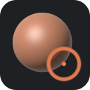

<p align="center">
  
</p>

<h1 align="center">OxyBrush</h1>

<p align="center"><strong>Open-source digital sculpting. Sculpt 3D models like digital clay.</strong></p>

<p align="center">
  <a href="https://github.com/crisprintsstuff/OxyBrush/releases"></a>
  <a href="https://github.com/crisprintsstuff/OxyBrush/actions/workflows/ci.yml"></a>
  
  <a href="rust-toolchain.toml"></a>
  
  <a href="#license"></a>
  <a href="https://github.com/crisprintsstuff/OxyBrush/releases"></a>
</p>

<p align="center">
  <a href="https://github.com/crisprintsstuff/OxyBrush/releases/latest"><b>Download</b></a> ·
  <a href="docs/TESTING_GUIDE.md">Testing guide</a> ·
  <a href="CHANGELOG.md">Changelog</a> ·
  <a href="docs/ROADMAP.md">Roadmap</a> ·
  <a href="https://github.com/crisprintsstuff/OxyBrush/issues/new?template=bug_report.yml">Report a bug</a>
</p>


OxyBrush is for sculptors: concept artists, character artists, miniature and 3D-print makers, and students. The model fills the screen, tools show up when you call for them, and brushes respond immediately even on dense meshes.

> **Alpha:** [v0.1.0-alpha](https://github.com/crisprintsstuff/OxyBrush/releases/latest) runs on Windows, Linux and macOS. You can sculpt multi-piece scenes, remesh, decimate, save projects and export for 3D printing. Expect rough edges, and keep copies of anything important. **Testers wanted** — see [Help test OxyBrush](#help-test-oxybrush).

## Download and install

Get the latest build from **[Releases](https://github.com/crisprintsstuff/OxyBrush/releases/latest)**.

| Platform | File | How |
|---|---|---|
| **macOS 11+** (Apple Silicon and Intel) | `…-macos-universal.dmg` | Open it and drag OxyBrush to Applications. The app isn't notarized yet, so the first launch is blocked: open **System Settings > Privacy & Security** and click **Open Anyway** (macOS 14 or older: right-click the app > **Open**). |
| **Windows 10/11** (64-bit) | `…-windows-x86_64-setup.exe` | Run it. Installs for your user without admin rights; adds a Start-menu entry, an uninstaller and `.oxb` file association. Windows warns about an unknown publisher (not code-signed yet): **More info → Run anyway**. |
| Windows, portable | `…-windows-x86_64-portable.zip` | Unzip and run `oxybrush.exe`. |
| **Linux** (Flatpak) | `…-linux-x86_64.flatpak` | `flatpak install --user OxyBrush-*.flatpak`, then launch from your app menu. Needs the Flathub remote for the runtime. |
| Linux, portable | `…-linux-x86_64.tar.gz` | Unpack and run `./oxybrush`. Needs a Vulkan or OpenGL driver and glibc ≥ 2.35. |

Each release has `SHA256SUMS.txt` for verifying downloads.

## Getting started

1. **Orbit** by dragging on empty space, **zoom** with the wheel, **pan** with the right mouse button. **F** frames the model.
2. **Sculpt** by dragging on the model. Pick brushes with **1–9, 0** or the left shelf; hold **Shift** to smooth, **Ctrl** to mask, **Alt** to invert; **[** / **]** resize the brush.
3. Need more detail? **D** subdivides; **Remesh** (right panel) rebuilds even topology.
4. **Ctrl+S** saves a project (`.oxb`); **Ctrl+E** exports OBJ or STL (e.g. for 3D printing).
5. **F1** shows every shortcut; **Help > Getting started guide** opens the full walkthrough.

## Help test OxyBrush

Testers are the most useful contribution right now — especially with **pen tablets**, **varied GPUs** and **3D printing workflows**.

1. Follow the [alpha testing guide](docs/TESTING_GUIDE.md) (about 20 minutes).
2. Report problems with **Help > Report a bug…** in the app — it opens a GitHub issue form with your version, OS and GPU already filled in. Attach the log from **Help > Open log folder**.
3. Share impressions with **Help > Send feedback…**: what felt good, what was frustrating, what you missed.

## Features

- **16 brushes:** Draw, Clay, Clay Strips, Smooth, Inflate, Flatten, Pinch, Crease, Layer, Grab, Snake Hook, Topological Move, Polish, Planar Trim, Noise, Mask. Each has falloff curves, spacing, auto-smooth and pen-pressure options.
- **Stroke control:** stabilizer for smooth lines, Freehand / Line / Stamp stroke modes, spray, pressure curve.
- **Alphas:** grayscale images shape each dab; seven built-in procedural alphas plus your own grayscale PNGs, with rotation and follow-stroke.
- **Masking and selection:** box or lasso mask/unmask and show/hide, mask by cavity, peaks or face group, blur/sharpen/grow/shrink the mask, grow/shrink the visible area.
- **Symmetry:** X/Y/Z mirroring plus radial symmetry (up to 64 copies around any axis).
- **Multiple pieces per document:** add, duplicate, mirror-duplicate, delete, rename, show/hide, solo. Alt+click a piece to make it active.
- **Voxel remesh:** rebuilds clean, even topology. "Merge visible" remeshes several pieces into one (a union).
- **Decimation:** quadric edge collapse that keeps open borders and face-group borders.
- **Face groups and hiding:** group visible, group from mask, group by islands, Ctrl+Shift+click to isolate a group, invert visibility, delete hidden, and a group color overlay.
- **Projects:** `.oxb` project files (versioned, checksummed, compressed, saved atomically), a prompt before discarding unsaved changes, **autosave every 2 minutes**, and **crash recovery** on the next launch.
- **Background jobs:** remesh, merge and decimate run on a worker thread, so the UI stays responsive.
- **Chunked mesh engine:** a stroke only re-computes, re-uploads and snapshots the regions it touches.
- **Undo/redo:** covers strokes, topology changes, face groups and visibility, and adding, removing or merging pieces, within a memory budget.
- **Matcap viewport (wgpu):** five procedurally generated materials (no third-party assets).
- **Import/export:** OBJ and STL import (as new pieces). OBJ and binary STL export of all visible pieces (3D-printing ready).
- **Accessibility basics:** UI scaling (75–300%), a high-contrast theme, a full mouse-only workflow, and screen-reader labels through AccessKit.
- **Pure Rust:** no C or C++ toolchain needed on Windows, Linux or macOS.

## Controls

| Input | Action |
|---|---|
| LMB on model | Sculpt the active piece |
| Alt+LMB on another piece | Make it the active piece |
| Ctrl+Shift+LMB | Isolate the face group under the cursor (on empty space: show all) |
| LMB on empty space | Orbit |
| Alt+LMB on empty space / RMB | Pan |
| Wheel | Zoom |
| Shift / Ctrl / Alt (hold) | Smooth / Mask / Invert |
| Ctrl+drag on empty space | Mask a rectangle or lasso (Ctrl+Alt: unmask; Ctrl+click: blur mask) |
| Ctrl+Shift+drag | Show only the selection (Ctrl+Shift+Alt: hide it) |
| `L` | Rectangle / lasso selection |
| Ctrl+M | Mask the face group under the cursor |
| `1`–`9`, `0` | Select brushes 1–10 |
| `[` `]` and `-` `=` | Radius and strength |
| `X` | Toggle X symmetry |
| `F` | Frame scene |
| `D` | Subdivide |
| Ctrl+R | Voxel remesh |
| `G` | Face group colors |
| Ctrl+S / Ctrl+O | Save / open project |
| Ctrl+Z, Ctrl+Shift+Z | Undo, redo |
| `F1` | Full shortcut list |

On macOS, **Cmd** works wherever Ctrl is listed and **Option** is Alt.

## Roadmap

Full plan and status: **[docs/ROADMAP.md](docs/ROADMAP.md)**.

| Phase | Goal | State |
|---|---|---|
| 0 | Foundations: workspace, CI, renderer, mesh core | ✅ |
| 1 | Sculpt core: brushes, symmetry, undo, pressure | ✅ (tablet pressure still being verified) |
| 2 | Pieces, voxel remesh, decimation, face groups, `.oxb` projects, autosave | ✅ first pass |
| — | Release packaging: Windows installer, Flatpak, macOS universal app | ✅ v0.0.1 / v0.1.0-alpha |
| 3 | **Sculpting depth:** stabilizer & stroke types ✅, masking/selection ✅, alphas ✅, more brushes ✅ · multiresolution, 10M-triangle performance ⏳ | 🚧 v0.1.0-alpha |
| 4 | Workflow: dynamic topology, vertex color, layers, symmetrize/projection, deformers & posing, viewport, quick palette, keymap editor | ⏳ |
| 5 | Hardening → **1.0** | ⏳ |
| Parallel | 3D-print tools · tablet input · ZBrush file research ([rules](docs/formats/zbrush/README.md)) | ⏳ · 🚧 · 🔬 M0 |
| After 1.0 | Auto-retopology, live booleans, armature spheres, poly modeling, UVs & baking, plugin API | long-term |

## For developers

### Building from source

You need Rust 1.88 or newer ([rustup](https://rustup.rs)).

```bash
git clone https://github.com/crisprintsstuff/OxyBrush
```

```bash
cd OxyBrush
```

```bash
cargo run --release
```

Open a project or mesh on launch:

```bash
cargo run --release -- path/to/model.oxb
```

**Windows:** install Rust with the MSVC toolchain (the rustup default). The Visual Studio Build Tools "Desktop development with C++" workload provides the linker; no other dependencies are needed.

**Linux packages:** X11 or Wayland development libraries and a Vulkan driver. On Debian or Ubuntu:

```bash
sudo apt install libxkbcommon-x11-0 libwayland-dev mesa-vulkan-drivers
```

**macOS and Windows:** nothing extra (Metal and DX12/Vulkan are used automatically).

### Architecture

```
crates/
  oxy-mesh     chunked triangle mesh, face groups/visibility, raycast, subdivision  (no GPU)
  oxy-topo     voxel remesh (with unions) and quadric decimation                  (no GPU)
  oxy-doc      scenes of pieces, .oxb project format, autosave/recovery           (no GPU)
  oxy-sculpt   stroke engine, brush kernels, symmetry, falloff                     (no GPU)
  oxy-history  scene-wide undo/redo (chunk snapshots, topology, pieces)           (no GPU)
  oxy-io       OBJ/STL import and export                                           (no GPU)
  oxy-render   wgpu matcap renderer and orbit camera
  oxy-app      winit + egui desktop app (binary: `oxybrush`)
```

Every crate except `oxy-render` and `oxy-app` runs headless and is unit-tested. The full design is in [RFC-0001](docs/rfcs/0001-oxybrush.md).

### Performance status

Measured with `cargo run --release -p oxy-sculpt --example dab_timing` on a 4-core cloud VM (CPU only), using a 1.3M-triangle sphere:

| Dab | Time |
|---|---|
| Small (~1k vertices) | ~0.7 ms |
| Large (~15k vertices) | ~2 ms |

Topology (`cargo run --release -p oxy-topo --example topo_timing`, same machine):

| Operation | Time |
|---|---|
| Voxel remesh, 330k triangles in, ~1M out (resolution 320) | ~2.3 s |
| Decimate 1.3M → 130k triangles | ~10 s |

Still to do for 1.0: dab cost at ~100k vertices (target ≤8 ms), faster decimation (batched or parallel collapses), and measurement on the reference hardware.

## Contributing

Everyone is welcome, whether you write code, make art, write docs, translate, or test. Read [CONTRIBUTING.md](CONTRIBUTING.md) first. In particular, every commit needs a DCO sign-off (`git commit -s`), and there is a **clean-room policy**.

## License

Code is dual-licensed under [MIT](LICENSE-MIT) or [Apache-2.0](LICENSE-APACHE), at your option. Bundled assets are CC0.

*OxyBrush is an independent project, not affiliated with any commercial sculpting software vendor. ZBrush is a registered trademark of Maxon Computer GmbH; it is mentioned only to identify a file format OxyBrush aims to interoperate with.*
