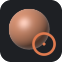
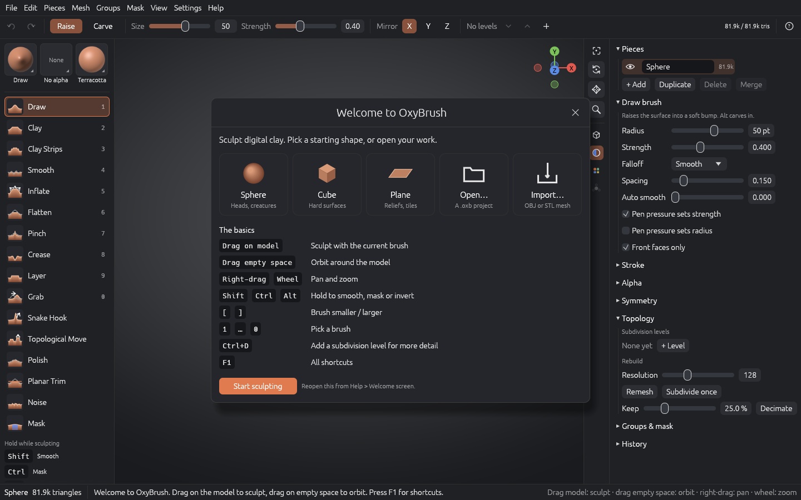
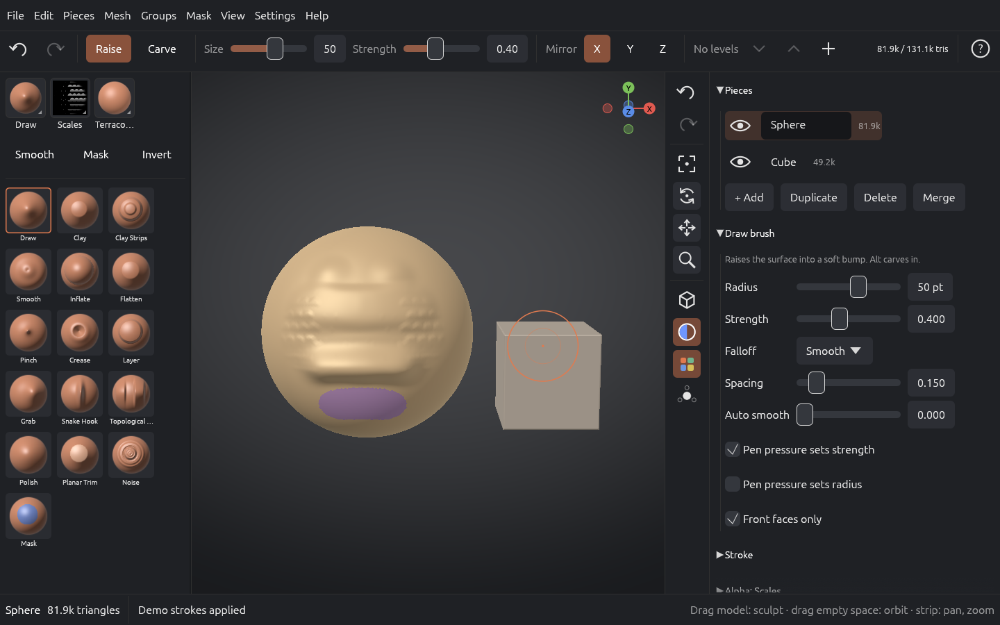
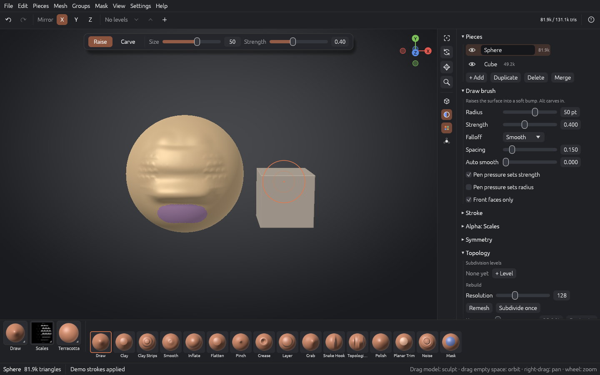

<p align="center">
  
</p>

<h1 align="center">OxyBrush</h1>

<p align="center"><strong>Open-source digital sculpting. Sculpt 3D models like digital clay.</strong></p>

<p align="center">
  <a href="https://github.com/crisprintsstuff/OxyBrush/releases"></a>
  <a href="https://github.com/crisprintsstuff/OxyBrush/actions/workflows/ci.yml"></a>
  
  <a href="rust-toolchain.toml"></a>
  
  <a href="#license"></a>
  <a href="https://github.com/crisprintsstuff/OxyBrush/releases"></a>
</p>


<p align="center">
  <a href="https://github.com/crisprintsstuff/OxyBrush/releases/latest"><b>Download</b></a> ·
  <a href="https://github.com/crisprintsstuff/OxyBrush/wiki"><b>Wiki & Docs</b></a> ·
  <a href="https://discord.gg/Vfm7Km7xvG"><b>Discord</b></a> ·
  <a href="docs/TESTING_GUIDE.md">Testing guide</a> ·
  <a href="CHANGELOG.md">Changelog</a> ·
  <a href="docs/ROADMAP.md">Roadmap</a> ·
  <a href="docs/PLANNED_FEATURES.md">Coming next</a> ·
  <a href="https://github.com/crisprintsstuff/OxyBrush/issues/new?template=bug_report.yml">Report a bug</a>
</p>


OxyBrush is a free, open-source sculpting app for concept artists, character artists, miniature and 3D-print makers, and students. You shape 3D models like digital clay. The model fills the screen, tools show up when you call for them, and brushes respond immediately, even on dense meshes.

> **Beta:** [v4.0.0-beta.6](https://github.com/crisprintsstuff/OxyBrush/releases/latest) runs on Windows, Linux and macOS. Expect rough edges and keep copies of anything important. **Testers wanted:** see [Help test OxyBrush](#help-test-oxybrush), or say hi on [Discord](https://discord.gg/Vfm7Km7xvG).

**Highlights**

- **19 sculpting brushes** plus masking, painting, cutting and primitive tools, with stroke stabilizer, editable curve strokes, alphas and pen pressure.
- **Subdivision levels and dynamic detail:** sculpt broad shapes low and fine detail high, or build up a plain sphere as you go.
- **Pieces:** many objects per scene, with voxel remesh, booleans, Join, Split, Symmetrize and decimation.
- **Retopology:** draw a clean quad mesh over a sculpt and project the detail onto it.
- **Poly Edit (first steps):** model a low-polygon piece by its faces: extrude, inset, move or delete them, one face or a whole loop, group or region at a time.
- **3D printing:** real-world size, volume and weight estimates, a wall-thickness check, hollowing with drain holes, and split-with-pins.
- **Vertex color and posing:** paint with masks and symmetry; pose with a mask and the transform gizmo or the Curve Move brush.
- **Your way of working:** four layouts, themes, a full keymap editor, tablet and touch support, and plugins in WebAssembly or Python.
- **Open files:** projects in `.oxb`; import OBJ, STL and ZBrush `.ztl`/`.zpr`; export glTF/GLB, OBJ, STL and PLY.

## Download and install

Get the latest build from **[Releases](https://github.com/crisprintsstuff/OxyBrush/releases/latest)**.

| Platform | File | How |
|---|---|---|
| **macOS 11+** (Apple Silicon and Intel) | `…-macos-universal.dmg` | Open it and drag OxyBrush to Applications. The app isn't notarized yet, so the first launch is blocked: open **System Settings > Privacy & Security** and click **Open Anyway** (macOS 14 or older: right-click the app > **Open**). |
| **Windows 10/11** (64-bit) | `…-windows-x86_64-setup.exe` | Run it. Installs for your user without admin rights; adds a Start-menu entry, an uninstaller and `.oxb` file association. Windows warns about an unknown publisher (not code-signed yet): **More info → Run anyway**. |
| Windows, portable | `…-windows-x86_64-portable.zip` | Unzip and run `oxybrush.exe`. |
| **Linux** (Flatpak) | `…-linux-x86_64.flatpak` | `flatpak install --user OxyBrush-*.flatpak`, then launch from your app menu. Needs the Flathub remote for the runtime. |
| Linux, portable | `…-linux-x86_64.tar.gz` | Unpack and run `./oxybrush`. Needs a Vulkan or OpenGL driver and glibc ≥ 2.35. |

Each release has `SHA256SUMS.txt` for verifying downloads.

## Getting started

The first time OxyBrush starts, a welcome window helps you pick a starting shape (sphere, cube or plane), open a project or import a mesh, and choose a layout. **File > Close project** brings it back, after asking to save unsaved work. Hover over any brush or control for a short explanation and its shortcut; on a touch screen, press and hold it.



1. **Orbit** by dragging on empty space, **zoom** with the wheel, **pan** with the right mouse button. **F** frames the model.
2. **Sculpt** by dragging on the model. Pick brushes with **1–9, 0** or the brush shelf; hold **Shift** to smooth, **Ctrl** to mask, **Alt** to invert; **[** / **]** resize the brush.
3. **Need more detail?** **Ctrl+D** adds a subdivision level, and **D** / **Shift+D** step between levels, keeping your detail. **Ctrl+R** remeshes to even triangles.
4. **Save** with **Ctrl+S** (an `.oxb` project). **Ctrl+E** exports glTF/GLB, OBJ, STL or PLY for game engines, other 3D apps or 3D printing.
5. **Find anything:** **Ctrl+K** finds any command by typing part of its name, **Space** finds a brush, **F1** lists every shortcut and **F2** opens the built-in guide (searchable, works offline). **Ctrl+,** opens Preferences.

### Make it yours

**Layouts** (Preferences > General, or in the welcome window):

| Layout | For |
|---|---|
| **Standard** | Mouse and keyboard: brush list with names and icons |
| **Compact** | Small screens: tighter spacing and an icon-only brush grid |
| **Touch friendly** | Touch screens and pen tablets: large buttons, a brush tile grid, on-screen **Smooth / Mask / Invert** toggles instead of modifier keys, and undo/redo beside the viewport |
| **Workstation** | Dense layout: a two-column brush shelf and the main controls in the top bar |



- **Arrange the panels** (Preferences > General, or right-click the brush shelf or the size/strength bar): put the brush shelf left, bottom or right; the settings panel left or right; and size, strength and Raise/Carve floating at the top or bottom of the viewport, or in the toolbar. **Drag brushes** in the shelf to reorder them; the number keys follow your order.
- **Fit more in the shelf:** turn off **Show brush names** (Preferences > Interface) for an icon grid, or use **Narrow brush shelf** for a single column.
- **Change the look** in **View > Theme…**: themes, accent and button colors, brush icon colors, the viewport background, interface scale, corners and slider thickness.



OxyBrush remembers your window, layout, arrangement, brush order, theme, material and other preferences between sessions. Turn on **Remember brush settings between sessions** (Preferences > General) to keep the current brush and each brush's strength too.

### Working with other apps

- **OxyCharacter:** OxyCharacter opens its character in OxyBrush as a project with a `character.oxb.oxylink.json` file next to it. OxyBrush shows **Linked to OxyCharacter** in the top bar; sculpt, add pieces, then click it (or **File > Send back to OxyCharacter**) to send the result back. Sculpted changes to `OxyCharacter Body` return as a morph and new pieces as accessories. To keep the body a morph, use subdivision levels rather than operations that change its topology (remesh, decimate, Boolean, split, delete hidden); OxyBrush warns you once if you do.
- **Blender:** the OxyBrush Bridge add-on sends meshes from Blender to OxyBrush and back ([RFC 0010](docs/rfcs/0010-blender-bridge.md)). It hasn't been tested inside Blender yet.
- **An AI agent on your computer** (off unless you turn it on): **Preferences > AI Agent** lets a program on this computer sculpt in the same scene as you. It listens only on this machine, shows **Agent connected** while one is here, and its edits undo like yours. Setup for common agents is in [docs/mcp.md](docs/mcp.md).

## Help test OxyBrush

Testers are the most useful contribution right now, especially with **pen tablets**, **varied GPUs** and **3D printing workflows**.

1. Follow the [testing guide](docs/TESTING_GUIDE.md) (about 20 minutes).
2. Report problems with **Help > Report a bug…** in the app. It opens a GitHub issue form with your version, OS and GPU filled in. Attach the log from **Help > Open log folder**.
3. See what's coming in [Coming next](docs/PLANNED_FEATURES.md) and tell us what you'd want first.
4. Share impressions with **Help > Send feedback…**, or chat with other testers on [Discord](https://discord.gg/Vfm7Km7xvG): what felt good, what was frustrating, what you missed.

## Features

### Sculpting

- **19 sculpting brushes, plus 7 tools in the same shelf:**
  - **Shape:** Draw, Clay, Clay Strips, Smooth, Inflate, Flatten, Pinch, Crease (with a Pinch setting for how tight the groove is), Layer, Polish, Planar Trim, Noise.
  - **Move:** Grab, Snake Hook, Topological Move, Curve Move, and the volume-preserving Kelvinlet brushes Kelvin Grab, Kelvin Twist and Kelvin Scale (after *de Goes & James, SIGGRAPH 2017*).
  - **Tools:** Mask, Paint (vertex color), Insert Primitives (sphere, cube, cylinder, cone, torus or plane that grows as you drag), Tube, and the screen-line cutting tools Plane Clip, Line Split and Cut Away, which follow symmetry.

  Each sculpting brush has falloff curves, spacing, auto-smooth and pen-pressure options. **Shift** smooths, and holding it while dragging changes the smoothing strength on the fly.
- **Strokes:** a stabilizer for smooth lines, Freehand, Line, Stamp and **Curve** stroke modes, spray, and a pressure curve. A Curve stroke stays editable after you draw it: drag, add or remove points, change size and strength per point, close it into a loop, and see the result live before you Accept ([RFC 0004](docs/rfcs/0004-curve-stroke.md)). In Freehand mode, hold still mid-stroke to turn it into a curve. **Edit > Last stroke** reopens the stroke you just made as an editable curve, or uses its path for a Curve Move curve or a tube.
- **Deform window** (Mesh > Deform…): whole-piece deformers that respect the mask: move, rotate, scale, bend, S-bend, skew, S-skew, three kinds of flatten, twist, taper, squeeze, perspective and sag; noise, inflate and spherize; and smooth, polish (plain, keeping detail, group edges or sharp edges) and relax. Drag a bar to see the result live and let go to apply it (on very large pieces the model catches up in the background while the bar follows the pointer, and a quick flick still applies); repeat it on this piece or on all others. Also Fit to standard size, Mirror and Symmetrize ([RFC 0016](docs/rfcs/0016-deform-window.md)).
- **Curve Move:** draw a curve along an arm or a tail, then drag its points. The part bends and stretches to follow, like a simple rig; masks protect what shouldn't move, and symmetry moves both sides ([RFC 0005](docs/rfcs/0005-curve-move.md)).
- **Tubes:** drag a path from the model or empty space to get a tube along it, shape its points and thickness, and edit it again later ([RFC 0009](docs/rfcs/0009-tube-tool.md)).
- **Alphas:** grayscale images shape each dab: seven built-in alphas plus your own PNGs, with rotation and follow-stroke. **Capture from view** turns what the viewport shows into an alpha (up to 4096 px), saved with the project; **Export alpha…** saves one as a 16-bit PNG to edit in a 2D app.
- **Brush presets:** save any brush (kind, size, strength, falloff, stroke, alpha) as a preset, and share it as a one-line code (`oxyb1:…`) or an `.oxbrush` file. Five starter presets are included.
- **Symmetry:** X, Y and Z mirroring that blends smoothly across the middle, plus radial symmetry (up to 64 copies around any axis). Each piece mirrors about its own centre, chosen from its shape when it's opened, with **Recentre** and **World origin** buttons to change it.
- **Quick menu at the cursor:** right-click or hold **Q** on the viewport for Raise/Carve, size, strength and the brush's own settings.

### Detail and topology

- **Subdivision levels:** add levels, sculpt broad shapes on a low level and fine detail on a high one; edits on a low level carry the higher-level detail along. Levels are saved in the project and covered by undo, with a configurable triangle limit (`max_triangles`).
- **Dynamic detail:** turn it on in the Topology section and brushes add triangles where they need more detail and remove ones that became too small, so you can build a shape from a plain sphere without remeshing. Works best up to a few hundred thousand triangles ([RFC 0006](docs/rfcs/0006-dynamic-detail.md)).
- **Voxel remesh:** rebuilds a piece with even triangles, on a sparse voxel grid that reaches 1024+ voxels across with little memory. An **Adaptivity** slider uses fewer triangles on flat areas, and quad output exports as quads in OBJ.
- **Booleans** (Mesh > Boolean): Union, Difference and Intersection on voxel volumes, robust to self-intersecting or non-manifold input.
- **Decimate:** reduces triangles while keeping the shape, open borders, face-group borders and vertex color (1.3M → 131k triangles in about 0.7 s on 4 cores).
- **Symmetrize** (Mesh > Symmetrize): makes a piece symmetric after the fact. It keeps one half, replaces the other with its mirror image and welds the seam (any axis, either side).
- **Retopology** (Mesh > Retopology): draw a clean quad mesh over a sculpt. Click to place points on the surface, Shift+click to make quads, Tab+drag a border edge to extend, Ctrl+click an edge to add a loop, Shift+drag to relax (Alt+click pins points so relax leaves them). The result is a new piece that exports as quads; **Subdivide and project** gives it levels that carry the sculpt's detail ([RFC 0012](docs/rfcs/0012-retopology.md)).
- **Poly Edit** (Mesh > Poly Edit, [RFC 0018](docs/rfcs/0018-poly-edit.md), first steps): model a low-polygon piece (a primitive, a retopology mesh, anything up to 400,000 triangles) by its faces. Point at a face to see what the action would change, then drag to **extrude** or **inset** it, drag to **move** it along its normal, or click to **delete** it. **Reach** spreads the action to the face loop, the face group, the flat region around it or the whole island; touching faces extrude as one block (or each on its own); Mirror across X does the other side too. Each drag is one undo step; Escape cancels. Faces with more than four corners are kept and saved. Edge and point actions, bevel and bridge come next.
- **Mesh repair:** Close holes, Delete hidden, and a Topology Diagnostics window that finds open edges, non-manifold edges and degenerate triangles.

### Pieces, masks and groups

- **Pieces:** many meshes per scene: add, duplicate, mirror-duplicate, delete, rename, show/hide, solo; Alt+click a piece to make it active. **Join** combines the visible pieces exactly as they are (each keeps its face groups); **Merge + remesh** fuses them into one closed surface. Split a piece by face groups, into loose parts, by its hidden faces or by its mask (**Split masked**).
- **Masking and selection:** paint a mask with Ctrl, or box or lasso it (following symmetry); mask by cavity, peaks or face group, or mask the border of the visible surface or the lines where face groups meet; blur, sharpen, grow, shrink or invert it. **Extract mask…** turns the masked area into a shell piece with live preview of its thickness.
- **Face groups and hiding:** group visible, group from mask, group by islands, Ctrl+Shift+click to isolate a group, invert visibility, and a group color overlay.
- **Transform gizmo (T):** move, rotate or scale a piece. With a mask, only the unmasked part moves and a soft mask edge bends smoothly, which makes it a quick posing tool. It snaps with Shift and has pivot choices and operators (mirror, put on the ground, centre at origin). Its fields show the move, turn or scale live while you drag; type a value and press Enter to land exactly on it. **Apply** keeps the changes; **Cancel**, or **Done** without Apply, puts them back (Redo brings them back).

### Color and viewport

- **Vertex color:** a Paint brush (Alt erases; works with alphas and symmetry), and fills for the whole piece, its cavities or its peaks, all respecting the mask. Color is kept through subdivision, remesh, booleans and decimate, and exported in glTF/GLB, PLY and OBJ.
- **Materials:** five built-in matcaps, or load your own (PNG or JPEG), previewed live as you hover. **Ambient occlusion and cavity shading** make folds and pores read clearly; **flat shading** shows every polygon.
- **Lights and shadows:** switch the viewport to up to four lights (sun, point or spot) with soft shadows, in **View > Shading > Light the viewport** and **Lights…** ([RFC 0008](docs/rfcs/0008-viewport-lights.md)).
- **Wireframe and floor grid:** a wireframe overlay (Shift+W) in a color of your choice, and a floor grid that follows the model's size and position.
- **Camera:** a focal length from 15 to 200 mm (35 mm equivalent), orthographic view, numpad side views, and an axis gizmo you click to snap to a side or drag to orbit.

### 3D printing

**Mesh > 3D Print Tools…** shows real-world size in millimetres, surface area and volume, checks that the mesh is closed, and estimates resin and filament weight. It also has:
- **Wall thickness:** finds walls that are too thin and paints them red/orange on the model.
- **Hollowing:** hollows a piece with a chosen wall thickness and adds drain holes.
- **Split for printing:** cuts a piece along X, Y or Z into parts with registration pins and matching sockets (0.2 mm clearance).

### Input and tablets

- **Pen pressure** for graphics tablets (Wacom, Huion, XP-Pen and others; Windows Ink; Linux X11 and Wayland), with an adjustable pressure curve, presets and a live readout in **Preferences > Pen & tablet**. The pen's side button works too.
- **Pen gestures:** drag with the pen in a panel to scroll it, and hold the pen still on a control to open its menu or read its tip. The **Pen side buttons** navigation preset orbits and pans with the side buttons ([RFC 0015](docs/rfcs/0015-pen-gestures.md)).
- **Touch:** pinch to zoom, two-finger orbit and pan, and two-finger tap to undo; trackpad pinch and rotate.
- **Keymap editor** (Preferences > Keymap): rebind every command, brush, view key and mouse button, with conflict warnings. Navigation presets: **OxyBrush**, **MMB orbit**, **Right-drag orbit** and **Pen side buttons**; shortcut presets **Default** and **Single-key tools**.

### Files and pipeline

- **Projects:** `.oxb` files are versioned, checksummed, compressed and saved safely (a crash mid-save never damages the old file). Open one by double-clicking it or dropping it on the window. **Autosave** every 2 minutes (adjustable) and **crash recovery** on the next launch.
- **Import:** OBJ and STL (each object becomes its own piece; broken material files don't stop an import), and ZBrush `.ztl` and `.zpr` files (each object becomes a piece, its groups become face groups). An import far larger or smaller than the scene, such as one in millimetres, is scaled to fit; one Undo keeps the original size.
- **Export:** all visible pieces to glTF 2.0 (`.glb`/`.gltf`), OBJ, binary STL or binary PLY, one object per piece.
- **Pipeline helpers:** make an LOD chain (1/2, 1/4 and 1/8 of the triangles), and the `oxybrush-cli` command-line tool for batch conversion, remeshing, decimation, LODs and splitting.

### Interface

- **Menus:** File, Edit, Pieces, Mesh, Groups, Mask, View, Plugins and Help, a toolbar with Raise/Carve, size, strength, symmetry and subdivision levels, and a view strip beside the viewport with toggles for the mask, face groups, shading, wireframe and floor grid.
- **Command palette (Ctrl+K)** for any command, brush, recent file or guide topic; a **brush finder (Space)**; and a searchable **offline guide (F2)**.
- **Accessibility:** interface scale from 75 to 300%, a high-contrast theme, a full mouse-only workflow, and screen-reader labels.
- **Undo/redo** covers strokes, topology changes, face groups, visibility and pieces, within a memory budget. **Undo on this piece** (Ctrl+Alt+Z) takes back the active piece's last change even if you changed other pieces since; turn on **Preferences > General > Undo works on the active piece** to make that what Ctrl+Z does. The History section can show just the active piece's changes.
- **Optional updates:** off by default. **Preferences > Updates** can tell you about new versions or download them in the background; installing always waits for you, and downloads are checksum-verified. Only GitHub is contacted, and nothing about you or your work is sent ([details](docs/rfcs/0002-updates.md)). Flatpak installs update through Flatpak.

### Plugins

- **Built-in plugins** in the **Plugins** menu, nothing to install: Displace, Mask by Height, Color Ramp, Array, Measure, Group by Height, Group by Angle, Hide Faces by Angle, Color by Group, Fill Holes, Simplify Mesh, Flip Faces and Squash. Some preview their result live before you Accept, long ones can be stopped, and their settings are remembered.
- **Your own plugins:** WebAssembly plugins run sandboxed inside OxyBrush, written in Rust, WebAssembly text or any language that compiles to WebAssembly. **Plugins > Install add-on…** adds an `.oxyaddon`. See the [plugin guide](docs/plugins/README.md) and [API reference](docs/plugins/api-reference.md).
- **Python scripts:** a zero-dependency Python SDK (`python/oxybrush`) talks to OxyBrush over the local AI-agent connection to inspect the scene, run strokes, remesh and more. Run a script with **File > Run Python script…** or manage scripts in **Preferences > Plugins**; examples are in `examples/plugins/`.

## Controls

| Input | Action |
|---|---|
| LMB on model | Sculpt the active piece |
| Alt+LMB on another piece | Make it the active piece |
| Ctrl+Shift+LMB | Isolate the face group under the cursor (on empty space: show all) |
| LMB on empty space | Orbit |
| Alt+LMB on empty space / RMB | Pan |
| Wheel | Zoom |
| Shift / Ctrl / Alt (hold) | Smooth / Mask / Invert |
| Ctrl+drag on empty space | Mask a rectangle or lasso, mirrored when symmetry is on (Ctrl+Alt: unmask; a box around nothing clears the mask; Ctrl+click: invert the mask) |
| Ctrl+Shift+drag | Show only the selection (Ctrl+Shift+Alt: hide it) |
| `L` | Rectangle / lasso selection |
| Ctrl+M | Mask the face group under the cursor |
| Ctrl+W | Group from mask: the masked faces become a new face group (with nothing masked, the visible faces do) |
| `1`–`9`, `0` | Select the first ten brushes in the shelf (drag brushes to rearrange) |
| `[` `]` and `-` `=` | Radius and strength |
| `S` / `U` / `I` / Shift+`O` | Slider under the pointer for size / strength / paint strength / focal shift (Single-key tools scheme: `O` for focal shift, `P` for orthographic) |
| `X` | Toggle X symmetry |
| `F` / Alt+`F` | Frame the active piece / all pieces |
| Ctrl+D | Add subdivision level |
| `D` / Shift+D | Subdivision level up / down |
| Ctrl+R | Voxel remesh |
| `G` | Face group colors |
| Shift+drag on empty space | Orbit in 45° steps |
| `T` | Transform gizmo: move → rotate → scale → off |
| `Shift`+drag a gizmo handle | Snap to steps (0.1, 15°, 10 %) |
| Ctrl+S / Ctrl+O | Save / open project |
| Ctrl+Z, Ctrl+Shift+Z | Undo, redo |
| Ctrl+Alt+Z, Ctrl+Alt+Shift+Z | Undo, redo on the active piece only |
| Right click / hold `Q` | Quick menu at the cursor (size, strength, Raise/Carve) |
| Alt with Grab / Snake Hook | Move along the surface normal |
| Middle-drag on a panel | Scroll the panel |
| Ctrl+K | Command palette |
| Space | Find a brush by name |
| `Ctrl+,` | Preferences window (General, Pen & tablet, Interface, Plugins, Keymap, AI Agent, Updates) |
| `F1` / `F2` | Full shortcut list / built-in guide |

These are the OxyBrush preset. **Preferences > Keymap** can change any of them, including the numpad view keys, and can switch the mouse to the MMB orbit or Right-drag orbit preset. On macOS, **Cmd** works wherever Ctrl is listed and **Option** is Alt.

## Roadmap

Full plan and status: **[docs/ROADMAP.md](docs/ROADMAP.md)**.

| Phase | Goal | State |
|---|---|---|
| 0 | Foundations: workspace, CI, renderer, mesh core | ✅ |
| 1 | Sculpt core: brushes, symmetry, undo, pressure | ✅ (tablet pressure still being verified) |
| 2 | Pieces, voxel remesh, decimation, face groups, `.oxb` projects, autosave | ✅ first pass |
| — | Release packaging: Windows installer, Flatpak, macOS universal app | ✅ v0.0.1-alpha – v4.0.0-beta.6 |
| 3 | **Sculpting depth and iPad:** stabilizer & stroke types ✅, masking/selection ✅, alphas ✅, more brushes & Kelvinlets ✅, subdivision levels ✅, touch layout ✅, performance first pass ✅ · rebuilding lower levels, 10M-triangle performance, iPad app with Apple Pencil ⏳ | 🚧 |
| 4 | Workflow: dynamic topology (first version ✅), vertex color ✅, symmetrize ✅, retopology ✅, posing ✅, deform window ✅, wireframe & lights ✅, themes ✅, command palette ✅, keymap editor ✅, plugins ✅, local AI agent (MCP) ✅ · layers ⏳ | 🚧 |
| 5 | Hardening → **1.0** | ⏳ |
| Parallel | 3D-print tools · tablet input · ZBrush file research ([rules](docs/formats/zbrush/README.md)) | ✅ · 🚧 · ✅ `.ztl`/`.zpr` import |
| After 1.0 | Auto-retopology, live booleans, armature spheres, poly modeling (first steps in 4.0 ✅), UVs & baking | long-term |

## For developers

### Building from source

You need [rustup](https://rustup.rs); it installs the Rust version pinned in `rust-toolchain.toml` (currently 1.99.1) the first time you build.

```bash
git clone https://github.com/crisprintsstuff/OxyBrush
```

```bash
cd OxyBrush
```

```bash
cargo run --release
```

Open a project or mesh on launch:

```bash
cargo run --release -- path/to/model.oxb
```

**Windows:** install Rust with the MSVC toolchain (the rustup default). The Visual Studio Build Tools "Desktop development with C++" workload provides the linker; no other dependencies are needed.

**Linux packages:** X11 or Wayland development libraries and a Vulkan driver. On Debian or Ubuntu:

```bash
sudo apt install libxkbcommon-x11-0 libwayland-dev mesa-vulkan-drivers
```

**macOS and Windows:** nothing extra (Metal and DX12/Vulkan are used automatically).

### Architecture

```
crates/
  oxy-mesh     chunked triangle mesh, face groups/visibility, raycast, subdivision  (no GPU)
  oxy-vdb      sparse voxel grid: remesh, booleans, level set filters            (no GPU)
  oxy-topo     voxel remesh, quadric decimation, 3D-print tools                   (no GPU)
  oxy-doc      scenes of pieces, .oxb project format, autosave/recovery           (no GPU)
  oxy-sculpt   stroke engine, brush kernels, symmetry, falloff                     (no GPU)
  oxy-history  scene-wide undo/redo (chunk snapshots, topology, pieces)           (no GPU)
  oxy-io       OBJ/STL and ZBrush import; glTF/GLB, OBJ, STL, PLY export          (no GPU)
  oxy-ztl      clean-room ZBrush (.ztl/.zpr) file reader                          (no GPU)
  oxy-cli      headless command-line tool (binary: `oxybrush-cli`)                (no GPU)
  oxy-mcp      local MCP server for an on-machine AI agent                        (no GPU)
  oxy-plugin   sandboxed WebAssembly plugins: manifest, runtime, host API         (no GPU)
  oxy-update   opt-in update checks: release choice, verification, HTTPS          (no GPU)
  oxy-render   wgpu matcap renderer, wireframe overlay, and orbit camera
  oxy-app      winit + egui desktop app (binary: `oxybrush`)
```

Every crate except `oxy-render` and `oxy-app` runs headless and is unit-tested. The full design is in [RFC-0001](docs/rfcs/0001-oxybrush.md).

### Python SDK

The `python/` directory contains the zero-dependency pure-Python `oxybrush` client library:

```bash
cd python
pip install -e .
```

Or run scripts directly against OxyBrush without installing:

```bash
PYTHONPATH=python python3 examples/plugins/mesh_stats.py
```

### Performance status

Measured on a 4-core cloud VM (CPU only; numbers vary ±10–20% between runs there). Brushes (`cargo run --release -p oxy-sculpt --example dab_timing`, 1.3M-triangle sphere):

| Dab | Time |
|---|---|
| Small (~1k vertices) | ~0.6 ms |
| Large (~15k vertices) | ~2–2.4 ms |

Subdivision levels (`cargo run --release -p oxy-mesh --example multires_timing`):

| Operation | Time |
|---|---|
| Switch to a 5.2M-triangle level | ~0.7 s, in the background |
| Add a level up to 5.2M triangles | ~2–4 s, in the background |
| UI-thread work for either | ~60 ms |

Topology (`cargo run --release -p oxy-topo --example topo_timing`):

| Operation | Time |
|---|---|
| Voxel remesh, 330k triangles in, 154k out (resolution 128) | ~0.3 s |
| Voxel remesh, 330k triangles in, 2.5M out (resolution 512) | ~2.4 s |
| Decimate 1.3M → 130k triangles | ~0.7 s |

Viewport passes on your own GPU: `cargo run --release -p oxy-render --example shading_timing`.

Still to do for 1.0: dab cost at ~100k vertices (target ≤8 ms), SIMD brush kernels, chunk frustum culling, and measurement on the reference hardware at 10M triangles.

## Contributing

Everyone is welcome, whether you write code, make art, write docs, translate, or test. Read [CONTRIBUTING.md](CONTRIBUTING.md) first. In particular, every commit needs a DCO sign-off (`git commit -s`), and there is a **clean-room policy**.

## License

Code is dual-licensed under [MIT](LICENSE-MIT) or [Apache-2.0](LICENSE-APACHE), at your option. Bundled assets are CC0, except the interface font, [Inter](https://rsms.me/inter/), which is under the [SIL Open Font License 1.1](crates/oxy-app/assets/fonts/OFL.txt).

*OxyBrush is an independent project, not affiliated with any commercial sculpting software vendor. ZBrush is a registered trademark of Maxon Computer GmbH; it is mentioned only to identify a file format OxyBrush aims to interoperate with.*
