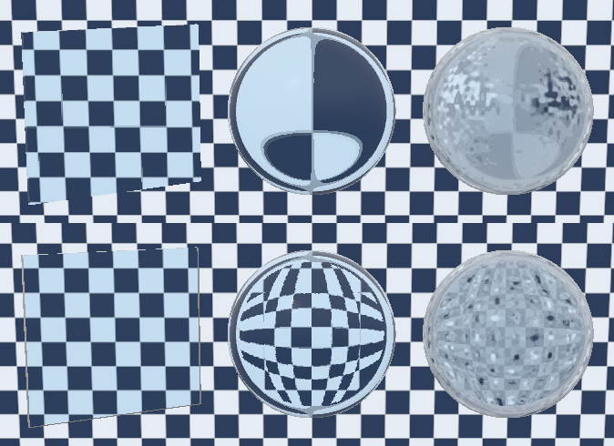

# Glass materials in the viewport

1. Select the piece you want to turn into glass.
2. Open **Materials > Glass** in the right inspector and pick **Clear Glass**
   or **Frosted Glass**. **View > Materials panel…** opens the inspector for you.
   The material tile above the brush shelf still offers these presets when
   you choose the active piece as the target.
3. Preview changes in the viewport. Click **Apply glass settings** to save
   them to the piece in one Undo step. The project keeps them when you reopen it.

| Control | When to use it |
| --- | --- |
| **Roughness** | Increase it to soften details seen through the glass. Use **Reseed frost** to vary the surface pattern on Frosted Glass. |
| **Refraction (IOR)** | Increase it to bend the background more. At 1.0, light passes through with no change of direction. |
| **Tint** | Pick the color of the light that passes through the piece. |
| **Absorption** | Raise it with a colored tint to deepen the color through thick areas. At zero, the tint is uniform. |
| **Exit refraction** | Turn it on for a closed pane or lens to bend light at the back surface too. It uses a back-face pass, so leave it off if you need a faster preview. |

With **Exit refraction** enabled, the tilted pane preserves the checkerboard
better and the clear sphere bends it like a lens. The frosted sphere shows
the same background with softer edges. A closed shell gives the most
reliable result. If the viewport can't find an exit, it uses the entry
surface alone. Glass uses visible opaque pieces and reference images as its
backdrop. Details near a viewport edge can shift as you orbit.
