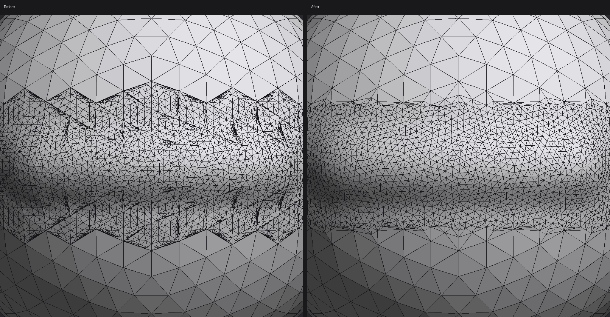

**OxyBrush 3.0.6-beta** makes **dynamic detail** produce even triangles that stay under the brush, fixes **saving to network drives** and the runaway **interface scale slider**, and lets the **retopology tool** carry your sculpt's detail. **Vertex color** is now exported, **tubes** can be edited after Accept, an open **Curve Move** curve is saved with the project, and brush settings can be **remembered between sessions**. It's still a beta: please [report issues](https://github.com/crisprintsstuff/OxyBrush/issues/new?template=bug_report.yml) (or use **Help > Report a bug…** in the app).

## Downloads

| Platform | File |
|---|---|
| **macOS 11+**, Apple Silicon and Intel (universal) | `OxyBrush-3.0.6-beta-macos-universal.dmg` |
| Windows 10/11 x64, installer | `OxyBrush-3.0.6-beta-windows-x86_64-setup.exe` |
| Windows, portable (includes `oxybrush-cli.exe`) | `OxyBrush-3.0.6-beta-windows-x86_64-portable.zip` |
| Linux, Flatpak | `OxyBrush-3.0.6-beta-linux-x86_64.flatpak` → `flatpak install --user OxyBrush-3.0.6-beta-linux-x86_64.flatpak` |
| Linux, portable (includes `oxybrush-cli`) | `OxyBrush-3.0.6-beta-linux-x86_64.tar.gz` |

Verify downloads with `SHA256SUMS.txt`.

**First launch:**
- **macOS:** open the `.dmg`, drag OxyBrush to Applications, and open it. If macOS shows an untrusted developer warning, go to **System Settings > Privacy & Security**, scroll down and click **Open Anyway**.
- **Windows:** SmartScreen warns about an unknown publisher: click **More info**, then **Run anyway**.

## Fixed

- **Dynamic detail makes even triangles and stays at the brush.** Refinement used to spread past the brush in zigzag spikes and leave thin, stretched triangles, so the surface looked crumpled. Now:
  - edges are split only under the brush;
  - new points follow the curve of the surface;
  - edges are flipped and points relaxed along the surface.

  On a test stroke, thin triangles went from 9% to none. Refining a very large mesh takes about 10% longer.

  
- **Saving to network drives** ([#117](https://github.com/crisprintsstuff/OxyBrush/issues/117)). Saving to an SMB share could fail with no visible message.
  - Saving now works around what such drives refuse, without risking the existing file.
  - It checks the file is there afterwards.
  - If saving still fails, a **Couldn't save** dialog shows the reason with a **Save As…** button.
- **The Interface scale slider no longer runs away** ([#116](https://github.com/crisprintsstuff/OxyBrush/issues/116)). The scale now changes when you let go, in 5% steps, and the Preferences window stays put.
- Switching subdivision levels without editing no longer nudges the lower levels.
- OBJ export keeps each mesh's exact quads, so strongly bent quads no longer come out as two triangles.

## New

- **Retopology: Subdivide and project.** In the Retopology window, this gives your retopology mesh 1–5 subdivision levels, each moved onto the sculpt. The top level carries the sculpt's detail, and level 1 stays exactly the quads you drew.
- **Vertex color in exports:** painted pieces keep their color in **glTF/GLB**, **PLY** and **OBJ**.
- **Edit a tube after Accept:** **Pieces > Edit tube…** reopens the piece's last tube, and **Update tube** replaces it as one undo step. Tubes stay editable after saving and reopening the project, until they're sculpted or remeshed.
- **Curve Move curves are saved with the project:** a curve that's open when you save comes back when you open the project, with the brush settings it was bending with.
- **Remember brush settings between sessions** (**Preferences > General**, off by default): the brush you were using, its settings and every brush's strength come back the next time OxyBrush starts.

See the [changelog](https://github.com/crisprintsstuff/OxyBrush/blob/main/CHANGELOG.md) for details.

## Project files

Projects from 3.0.5-beta open unchanged. Tubes and an open Curve Move curve are saved in two new sections. Older versions skip them: tubes stay ordinary triangles, and the piece opens without the curve.

## Known limitations

- **Not yet tried by testers:** everything above. Network-drive saving was tested only with simulated failures, not on a real SMB share; please try it and send the log if it still fails.
- **Dynamic detail** is smooth up to a few hundred thousand triangles and lags behind the brush around a million. Where new detail meets the untouched mesh there's still one row of thinner triangles.
- **Tubes:** only a piece's latest tube can be edited again.
- **Curve Move:** only one curve at a time; an applied curve can't be edited again.
- **Retopology:** Tab+drag makes one quad at a time, and edge loops can't be slid.
- The Blender bridge add-on still hasn't been run inside Blender.
- macOS is not notarized; pen pressure and touch gestures are untested on many tablets.

*OxyBrush is an independent project, not affiliated with any commercial sculpting software vendor.*
