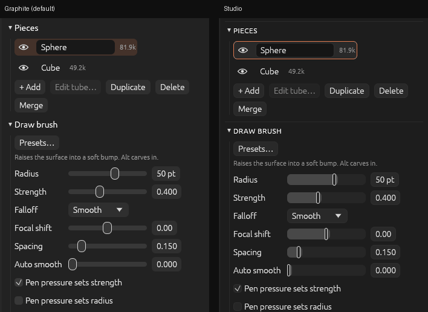

**OxyBrush 3.0.7-beta** fixes **pen pressure on Linux tablets** and adds a new **Studio theme** with bar sliders. The window now **reopens where you left it**, files **open when you drop them on the window** (and by double-click on macOS), and meshes use about **18% less memory**. In-app plugins get a major upgrade with **plugin API 3**, plus a new **plugin guide**. It's still a beta: please [report issues](https://github.com/crisprintsstuff/OxyBrush/issues/new?template=bug_report.yml) (or use **Help > Report a bug…** in the app).

## Downloads

| Platform | File |
|---|---|
| **macOS 11+**, Apple Silicon and Intel (universal) | `OxyBrush-3.0.7-beta-macos-universal.dmg` |
| Windows 10/11 x64, installer | `OxyBrush-3.0.7-beta-windows-x86_64-setup.exe` |
| Windows, portable (includes `oxybrush-cli.exe`) | `OxyBrush-3.0.7-beta-windows-x86_64-portable.zip` |
| Linux, Flatpak | `OxyBrush-3.0.7-beta-linux-x86_64.flatpak` → `flatpak install --user OxyBrush-3.0.7-beta-linux-x86_64.flatpak` |
| Linux, portable (includes `oxybrush-cli`) | `OxyBrush-3.0.7-beta-linux-x86_64.tar.gz` |

Verify downloads with `SHA256SUMS.txt`.

**First launch:**
- **macOS:** open the `.dmg`, drag OxyBrush to Applications, and open it. If macOS shows an untrusted developer warning, go to **System Settings > Privacy & Security**, scroll down and click **Open Anyway**.
- **Windows:** SmartScreen warns about an unknown publisher: click **More info**, then **Run anyway**.

## Fixed

- **Pen pressure on Linux** (X11, XWayland and the Flatpak). Tablets report pressure as a raw reading, from 0 up to a few thousand, and OxyBrush only understood values from 0 to 1, so on most tablets pressure did nothing. The pen's pressure axis is now read properly. The log says "pen pressure is coming in" once it works.
- **Double-clicking a `.oxb` file on macOS opens it** ([#135](https://github.com/crisprintsstuff/OxyBrush/issues/135)), instead of "can't open files of this type". Open With and the Dock work too.
- **Insert Primitive, Duplicate and dynamic detail** work again with **Settings > Subdivision limit** set to **Unlimited**. They had taken "Unlimited" as a limit of zero triangles: inserting said "would exceed maximum triangle limit 0" and added nothing.
- **Stopping a plugin** right after starting it now works.

## New

- **Studio theme** (**Preferences > Appearance**): flat neutral greys, sliders drawn as bars, small uppercase section headings, and an orange outline on what's selected. It's optional; Graphite stays the default.

  
- **Hide brush names in the shelf** (**Preferences > Appearance**): the brushes become a grid of icons, so they all fit at once; hover one for its name.
- **Narrow brush shelf** (**Preferences > Appearance**): a side shelf becomes one narrow column, with the current brush, alpha and material stacked at the top, then one brush per row with its name underneath.
- **The window opens where you left it** ([#95](https://github.com/crisprintsstuff/OxyBrush/issues/95)): its size, position and maximized state are remembered. If it was last on a monitor that's no longer connected, it opens on one that is.
- **Drop files on the window to open them**, on every system: a project, a mesh to import, or an add-on to install.
- **Plugin API 3** for in-app plugins. Plugins can now:
  - change face groups, hidden faces and a piece's triangles;
  - show their result live before you **Accept** it;
  - offer switches, choices, colors and text in their panels;
  - remember their settings;
  - show progress, with a **Stop** button.

  New bundled plugins: **Group by Height** and **Flip Faces**; **Displace** now previews. Plugins written for earlier versions keep working.
- **Plugin guide and API reference** in [`docs/plugins`](https://github.com/crisprintsstuff/OxyBrush/tree/main/docs/plugins) and on the [wiki](https://github.com/crisprintsstuff/OxyBrush/wiki/In-App-Plugins), with WebAssembly-text and Rust examples.

## Changed

- **Meshes use about 18% less memory**, and are built a little faster. The Smooth and Polish brushes take slightly longer per dab (about 0.4 ms on a large brush).

See the [changelog](https://github.com/crisprintsstuff/OxyBrush/blob/main/CHANGELOG.md) for details.

## Project files

Projects from 3.0.6-beta open unchanged; the project format didn't change in this release.

## Known limitations

- **Not yet tried by testers:** everything above. Please check pen pressure on a Linux tablet, and double-clicking a `.oxb` file on macOS. Linux pen pressure relies on the tablet's pressure axis being labelled "Abs Pressure", as the common drivers do.
- If you already have the **Displace** plugin, you keep your old copy, without preview, until you delete its folder (**Plugins > Open plugins folder**) and restart.
- Dynamic detail is smooth up to a few hundred thousand triangles, and adding a subdivision level to a multi-million-triangle sculpt still pauses for a moment. Both are next on the list.
- The Blender bridge add-on still hasn't been run inside Blender.
- macOS is not notarized; pen pressure and touch gestures are untested on many tablets.

*OxyBrush is an independent project, not affiliated with any commercial sculpting software vendor.*
