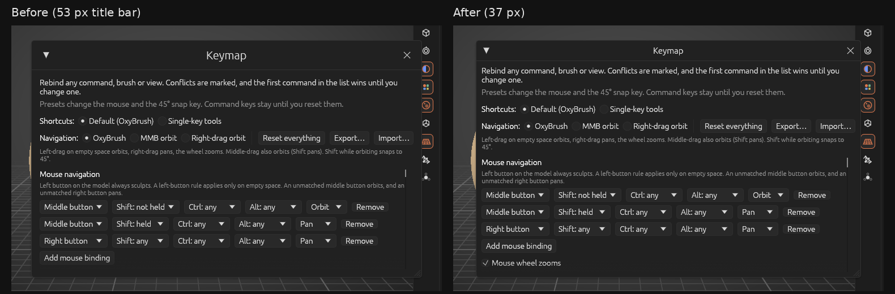
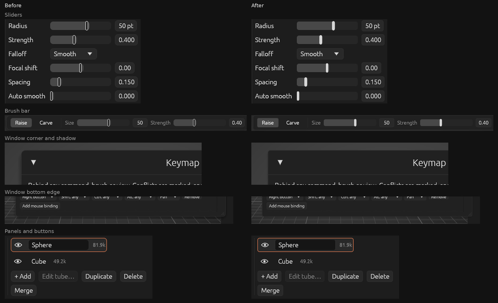

**OxyBrush 3.0.8-beta** makes **window title bars** much slimmer and refines the **Studio theme**: slider handles are solid bars, corners are a little squarer, and windows and menus cast a smaller, fainter shadow. It's still a beta: please [report issues](https://github.com/crisprintsstuff/OxyBrush/issues/new?template=bug_report.yml) (or use **Help > Report a bug…** in the app).

## Downloads

| Platform | File |
|---|---|
| **macOS 11+**, Apple Silicon and Intel (universal) | `OxyBrush-3.0.8-beta-macos-universal.dmg` |
| Windows 10/11 x64, installer | `OxyBrush-3.0.8-beta-windows-x86_64-setup.exe` |
| Windows, portable (includes `oxybrush-cli.exe`) | `OxyBrush-3.0.8-beta-windows-x86_64-portable.zip` |
| Linux, Flatpak | `OxyBrush-3.0.8-beta-linux-x86_64.flatpak` → `flatpak install --user OxyBrush-3.0.8-beta-linux-x86_64.flatpak` |
| Linux, portable (includes `oxybrush-cli`) | `OxyBrush-3.0.8-beta-linux-x86_64.tar.gz` |

Verify downloads with `SHA256SUMS.txt`.

**First launch:**
- **macOS:** open the `.dmg`, drag OxyBrush to Applications, and open it. If macOS shows an untrusted developer warning, go to **System Settings > Privacy & Security**, scroll down and click **Open Anyway**.
- **Windows:** SmartScreen warns about an unknown publisher: click **More info**, then **Run anyway**.

## Fixed

- **Window title bars are no longer huge.** They were about twice the height of a normal row (53 px at 100% scale, more at larger interface scales). They're now about 37 px, and windows show more of their content. Headings inside windows are a little smaller as well.

  

## Changed

In the **Studio** theme (**Preferences > Appearance**):

- **Slider handles are solid bars**, with no outline. They still turn to the accent color while you hover or drag them.
- **Corners are a little squarer:** buttons, fields, windows, menus and tiles use 60% of the chosen corner style's radius.
- **Windows and menus cast a smaller, fainter shadow**, so they sit just off the panels instead of floating above them.

The other themes are unchanged.

See the [changelog](https://github.com/crisprintsstuff/OxyBrush/blob/main/CHANGELOG.md) for details.

## Project files

Projects from 3.0.7-beta open unchanged; the `.oxb` format didn't change in this release.

## Known limitations

- **Not yet tried by testers:** the slimmer title bars and the Studio refinements were checked in headless screenshots only. The hover and drag colors of the solid handle haven't been seen on a real display.
- Everything listed for 3.0.7-beta still applies: Linux pen pressure and double-clicking `.oxb` files on macOS await confirmation from testers.
- **Dynamic detail** is smooth up to a few hundred thousand triangles and lags behind the brush around a million.
- The Blender bridge add-on still hasn't been run inside Blender.
- macOS is not notarized; pen pressure and touch gestures are untested on many tablets.

*OxyBrush is an independent project, not affiliated with any commercial sculpting software vendor.*
