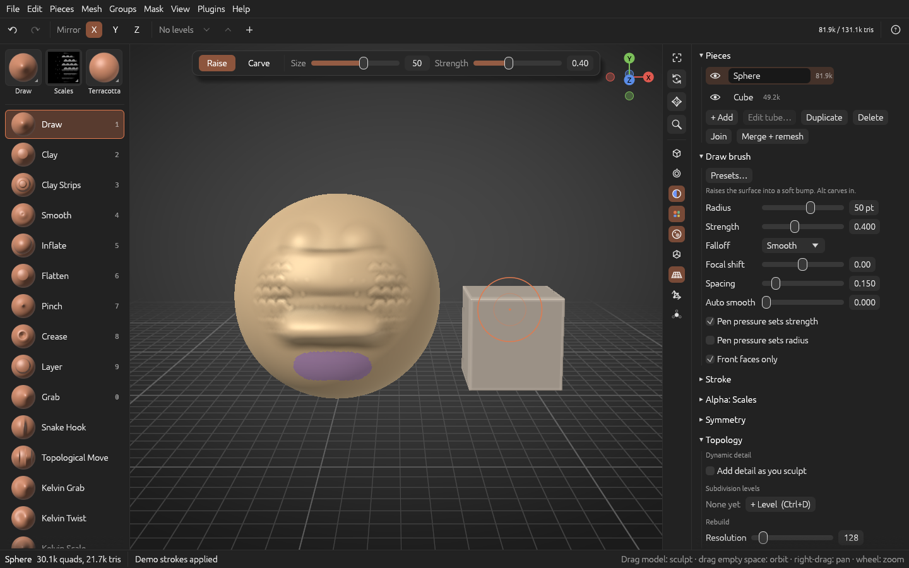

**OxyBrush 4.0.0-beta.9** makes subdivision levels out of **quads**, so a quad model keeps its edge loops as you add detail, and adds ways to put resolution exactly where you want it: a **Smooth** toggle for levels that keep the shape, and **Subdivide masked** for one part only. **Living strokes** can now be grouped into layers and are saved with the project, there's a new **Disc** primitive, and the voxel remesh keeps close fingers and toes apart. It's still a beta: please [report issues](https://github.com/crisprintsstuff/OxyBrush/issues/new?template=bug_report.yml) (or use **Help > Report a bug…** in the app), or talk about it on [Discord](https://discord.gg/Vfm7Km7xvG).

## Downloads

| Platform | File |
|---|---|
| **macOS 11+**, Apple Silicon and Intel (universal) | `OxyBrush-4.0.0-beta.9-macos-universal.dmg` |
| Windows 10/11 x64, installer | `OxyBrush-4.0.0-beta.9-windows-x86_64-setup.exe` |
| Windows, portable (includes `oxybrush-cli.exe`) | `OxyBrush-4.0.0-beta.9-windows-x86_64-portable.zip` |
| Linux, Flatpak | `OxyBrush-4.0.0-beta.9-linux-x86_64.flatpak` → `flatpak install --user OxyBrush-4.0.0-beta.9-linux-x86_64.flatpak` |
| Linux, portable (includes `oxybrush-cli`) | `OxyBrush-4.0.0-beta.9-linux-x86_64.tar.gz` |

Verify downloads with `SHA256SUMS.txt`.

**First launch:**
- **macOS:** open the `.dmg`, drag OxyBrush to Applications, and open it from there. If macOS shows an untrusted developer warning, go to **System Settings > Privacy & Security**, scroll down and click **Open Anyway**.

## New

- **Subdivision levels make quads** (Ctrl+D, Mesh > Subdivide, the retopology tool's Subdivide and project). Every polygon becomes quads, so the human base meshes, Poly Edit models, retopology meshes and quad spheres keep their edge loops at every level, the quad count is exact and OBJ export writes quads. Poly Edit creases stay sharp in the levels. The old triangle subdivision (Loop) is still there: **Topology > Subdivision levels > Makes: Triangles**, chosen before the first level.
- **Smooth toggle** (Topology > Subdivision levels, on by default). Off, a new level or Subdivide only splits the faces and keeps the shape exactly: for hard-surface parts, or more resolution without softening. Each level keeps how it was made.
- **Subdivide masked** (Mask and Mesh menus). More resolution only where you mask, for example one feather of an imported model: **Groups > Group by islands**, **Ctrl+M** on the part, then Subdivide masked. The rest of the model doesn't move. Step by step: [Adding detail to one part of a model](https://github.com/crisprintsstuff/OxyBrush/blob/main/docs/guides/detail-on-one-part.md).
- **Living strokes, second phase** (Mesh > Strokes…, with Living strokes on in Preferences > General):
  - **Groups**, used like sculpt layers, each with its own strength slider and show/hide box. You can rename, merge and ungroup them.
  - **Keep only where unmasked** takes away the masked part of a stroke.
  - **Strokes are saved with the project**, so they stay editable after you reopen it.
- **Disc primitive** (Pieces > + Add > Disc): a flat round plate of quads, a ring with a hole (Inner radius), or a slice of either.

## Fixed

- **Voxel remesh no longer bridges close parts.** Fingers, toes, lips and nail folds that came within about a voxel of each other were pinched together. Smoothing could then tear those spots into shreds. They now stay apart and the surface is clean. Parts closer than about a voxel still join, so raise the resolution to keep them apart.

See the [changelog](https://github.com/crisprintsstuff/OxyBrush/blob/main/CHANGELOG.md) for details.

## Project files

Projects from earlier betas open unchanged. This beta adds three new project sections, and older versions open files that have them as follows:

| New section | What it saves | In older versions |
|---|---|---|
| `MRCC` | Quad subdivision levels | Open the current level as a plain mesh |
| `MRLN` | Levels made without smoothing | Read the same points |
| `STRK` | Living strokes | Open with the strokes fixed in place |
