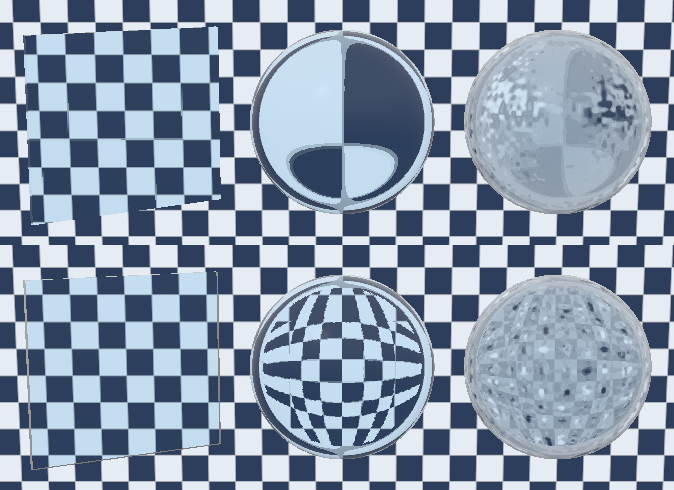

**OxyBrush 4.2.0** adds OxyMorph (Beta) for sculpting and blending variants, plus Clear Glass and Frosted Glass viewport materials. It also improves crowded OxySpheres joints, Plane Clip, and Poly Edit selection. This release covers the changes since 4.1.4.

## Downloads

| Platform | File |
|---|---|
| macOS 11+, Apple Silicon and Intel | `OxyBrush-4.2.0-macos-universal.dmg` |
| Windows 10/11 x64, installer | `OxyBrush-4.2.0-windows-x86_64-setup.exe` |
| Windows, portable (includes `oxybrush-cli.exe`) | `OxyBrush-4.2.0-windows-x86_64-portable.zip` |
| Linux, Flatpak | `OxyBrush-4.2.0-linux-x86_64.flatpak` |
| Linux, portable (includes `oxybrush-cli`) | `OxyBrush-4.2.0-linux-x86_64.tar.gz` |
| Blender 4.2+, bridge extension | `OxyBrush-4.2.0-blender-extension.zip` |

Verify downloads with `SHA256SUMS.txt`. [Installation instructions](https://github.com/crisprintsstuff/OxyBrush#download-and-install)

## OxyMorph (Beta)

Open **Tools > OxyMorph (Beta)** and fork an editable B variant from the active piece. Choose **Compare A / Mix / B** to sculpt either variant while the center mix updates. All three panes share the same camera. Paint **Keep A** or **Keep B** on the mix to pin areas to one variant, and use **Erase** to return an area to the global blend. **Create piece from mix** makes an editable result in one undo step. Save the project with the panel open to resume the source pair, painted pins, and comparison view. Autosave includes paint-only changes. The two variants need matching topology. [RFC 0056](https://github.com/crisprintsstuff/OxyBrush/blob/main/docs/rfcs/0056-sculpt-variants.md)

## Glass viewport materials

In **Materials**, target an individual piece and choose **Clear Glass** or **Frosted Glass**. Preview tint, roughness, and refraction, and reseed the procedural frost for a different pattern. With a colored tint, **Absorption** deepens the color through thicker parts of a closed piece. Turn on **Exit refraction** for panes and lenses to bend light at both surfaces. The extra pass is opt-in. **Apply glass settings** records one undo step, and the project keeps the settings with the piece. Glass samples visible geometry and reference images in the viewport. [Illustrated guide](https://github.com/crisprintsstuff/OxyBrush/wiki/Glass-Materials)

Linux CI now checks glass rendering, opaque occlusion, and clipping at the split-view divider. [#649](https://github.com/crisprintsstuff/OxyBrush/pull/649)

## Modeling improvements

- **OxySpheres quad base mesh** retries crowded three-way joints with narrower sockets. The editable armature is kept when a fit fails. [#642](https://github.com/crisprintsstuff/OxyBrush/pull/642)
- **Plane Clip** follows the drawn Curve or closed shape and preserves depth as vertices move to the cutter boundary. [#638](https://github.com/crisprintsstuff/OxyBrush/issues/638)
- **Poly Edit area selection** now picks through the piece by default. Turn on **Front only** to restrict Box, Lasso, and Ellipse to visible faces, edges, or points. [#636](https://github.com/crisprintsstuff/OxyBrush/issues/636)

[Full comparison with 4.1.4](https://github.com/crisprintsstuff/OxyBrush/compare/v4.1.4...v4.2.0) · [Changelog](https://github.com/crisprintsstuff/OxyBrush/blob/main/CHANGELOG.md)
