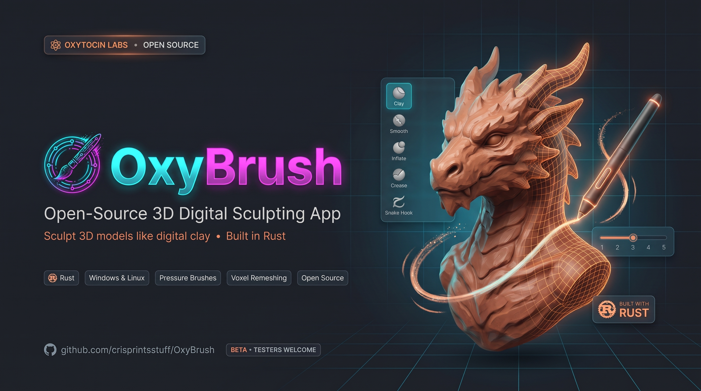

**OxyBrush 4.2.1** adds groomable fur previews, dockable menus, and screenshot export. It also brings glass and matcap controls into the Materials inspector and makes the brush shelf's selection shapes easier to reach. This release covers the changes since 4.2.0.

## Downloads

| Platform | File |
|---|---|
| macOS 11+, Apple Silicon and Intel | `OxyBrush-4.2.1-macos-universal.dmg` |
| Windows 10/11 x64, installer | `OxyBrush-4.2.1-windows-x86_64-setup.exe` |
| Windows, portable (includes `oxybrush-cli.exe`) | `OxyBrush-4.2.1-windows-x86_64-portable.zip` |
| Linux, Flatpak | `OxyBrush-4.2.1-linux-x86_64.flatpak` |
| Linux, portable (includes `oxybrush-cli`) | `OxyBrush-4.2.1-linux-x86_64.tar.gz` |
| Blender 4.2+, bridge extension | `OxyBrush-4.2.1-blender-extension.zip` |

Verify downloads with `SHA256SUMS.txt`. [Installation instructions](https://github.com/crisprintsstuff/OxyBrush#download-and-install)

## Grow and groom fur

Select a single-level sculpt piece, open **Materials > Fur**, and grow a coat across the piece, a masked area, or a face group. Adjust spacing, length, and width, then use **Comb** to lean the strands with a brush stroke. Growing, grooming, resizing, and removing the coat support Undo. Fur follows sculpt edits and saves with the project as a viewport preview. Topology changes pause the preview until you restore the original surface or grow a new coat. [#651](https://github.com/crisprintsstuff/OxyBrush/pull/651) · [#652](https://github.com/crisprintsstuff/OxyBrush/pull/652)

## Keep materials and tools beside the viewport

- Open **View > Materials panel…** for Matcaps, Glass, and Fur. The shelf picker stays open when switching between Clear Glass and Frosted Glass. Choose **Glass settings…** to preview slider changes in the inspector and **Apply glass settings** to save them in one Undo step. The **View > Material** submenu also stays open for matcap comparisons. [#652](https://github.com/crisprintsstuff/OxyBrush/pull/652) · [#655](https://github.com/crisprintsstuff/OxyBrush/pull/655)
- Drag the heading of Materials, Pieces, Mesh, Tools, Groups, Mask, or View to a sidebar, or click **Dock left** or **Dock right**. Move or undock a menu from its section. OxyBrush remembers where you put it. [#656](https://github.com/crisprintsstuff/OxyBrush/pull/656)

## Export screenshots

Choose **File > Export screenshot…** to save the viewport or the full window as PNG, JPEG, or WebP. Viewport capture includes both panes in split view. Choose the full window to include the interface in a bug report. [#653](https://github.com/crisprintsstuff/OxyBrush/pull/653)

## Selection and Line Split

Use the dedicated Selection tile to pick Rectangle, Lasso, Circle, Ellipse, or Curve. Ctrl and Ctrl+Shift keep the brush shelf in place. Plane Clip, Line Split, and Cut Away use their own shape choice and also offer a straight Line. A successful shaped Line Split reveals the assigned face group, including when Wireframe is on. [#654](https://github.com/crisprintsstuff/OxyBrush/issues/654) · [#655](https://github.com/crisprintsstuff/OxyBrush/pull/655)

[Full comparison with 4.2.0](https://github.com/crisprintsstuff/OxyBrush/compare/v4.2.0...v4.2.1) · [Changelog](https://github.com/crisprintsstuff/OxyBrush/blob/main/CHANGELOG.md)
