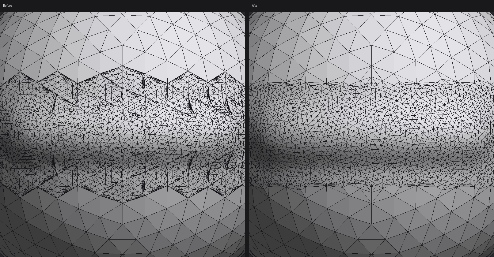

# RFC 0006: Dynamic detail (dynamic topology), first version

- **Status:** proposed for the maintainer; first version implemented in the same change for review
- **Requested by:** a user in [#81](https://github.com/crisprintsstuff/OxyBrush/issues/81),
  who uses a mode like this in other sculpting apps as their main way to
  start a shape. The roadmap already lists dynamic topology for Phase 4.
  No other app's documentation, code or UI was consulted (see
  [CLEAN_ROOM.md](../CLEAN_ROOM.md)).

## Problem

Sculpting from a simple sphere runs out of triangles fast: a horn pulled
out with Snake Hook stretches a few big triangles, and fine detail needs
the whole piece remeshed or subdivided first, which adds triangles
everywhere, not where they're needed.

## Decision

**Dynamic detail** (Topology section, also in the command palette): while
it's on, sculpting brushes refine the mesh as they go, splitting triangles
that are too big for the brush and merging ones that have become too
small. Detail is added only where you sculpt.

- **Detail** slider (0–100%): the target edge length is a fraction of the
  brush radius, from half the radius at 0% to a twentieth at 100%
  (`radius · 0.5 · 0.1^detail`). As in other apps with this mode, a
  smaller brush gives finer detail, so you work from big forms to small
  ones just by changing the size.
- **Which brushes:** every sculpting brush, including Snake Hook and
  Smooth. Not Mask and Paint (they don't change shape), the Grab-like
  brushes (they move a region captured at the start of the stroke), Insert
  Primitives or the cutting tools.
- **Symmetry:** the mirrored and radial copies of the brush refine too.
- **Masks:** fully masked areas keep their triangles.
- **Hidden** faces and **open rims** (edges with one triangle) are never
  changed.
- **Pieces with subdivision levels:** off, with a note: changing triangles
  would throw the levels away.
- **Undo:** a stroke that changed the triangles is one undo step that
  restores the whole piece as it was before the stroke.
- **Triangle limit:** refinement stops at the app's maximum triangle count,
  with a status message.

## How it works

`oxy_mesh::dyntopo::refine` (GPU-free, unit-tested), for a set of spheres:

1. The **region** is every triangle touching a vertex inside a sphere.
2. **Split** (up to six rounds, longest edges first): edges longer than 4/3
   of the target with an end inside a sphere are split; both triangles on
   the edge are split, so there are no T-junctions. Mask and color are
   interpolated; face groups are inherited.
   - The new vertex is the midpoint of the cubic Hermite curve between the
     ends whose tangents lie in each end's tangent plane:
     `(a + b)/2 + ((d·n_b) n_b − (d·n_a) n_a)/8`, with `d = b − a`. The
     straight chord's midpoint lies θ²/2 inside a sphere; this one lies
     within θ⁴/4, so refining keeps curved surfaces curved.
   - (Since 3.0.6) An edge is split only if an end lies *inside a sphere*.
     The first version allowed any edge with a new vertex at one end, so
     every round spread one ring of triangles further out (a tester's video
     showed refinement in zigzag spikes well past the brush).
3. **Collapse** (two rounds, shortest first): edges shorter than 4/5 of the
   target with both ends inside are collapsed to their midpoint, unless
   that would break the surface. It's refused when:
   - the link condition fails (the two ends share neighbours other than
     the two opposite corners);
   - either end has only three neighbours;
   - an end lies on a rim;
   - any triangle around it would flip or degenerate;
   - an edge would come out longer than 4/3 of the target.

   The 4/3 and 4/5 thresholds are from Botsch and Kobbelt, "A Remeshing
   Approach to Multiresolution Modeling" (SGP 2004).
4. **Flip** (since 3.0.6; two rounds): an edge with both ends inside a
   sphere is flipped when that brings its four vertices closer to six
   neighbours each, the third step of the same paper. It isn't flipped
   when:
   - its two triangles are bent more than about 20° apart (so sculpted
     ridges and creases keep their edges), or are in different face groups;
   - the new edge would be longer than 4/3 of the target, or already exists;
   - a new triangle would face the other way or be degenerate.
5. **Relax** (since 3.0.6; two rounds): each vertex inside a sphere moves
   half way toward the middle of its neighbours, within its tangent plane
   (the paper's fourth step). Rims, masked (in proportion) and hidden areas
   stay, and a move that would fold a triangle is skipped. A move in the
   tangent plane leaves a curved surface, so the vertex also drops by the
   curvature of a fit `h = k·t²` to its neighbours' heights over that plane.

   Measured on a Draw-like stroke over a coarse sphere at Detail 62%
   (`cargo run --release -p oxy-mesh --example dyntopo_quality`):

   | | First version | Since 3.0.6 |
   |---|---|---|
   | Thin triangles (smallest angle under 20°) | 8.9% | 0.0% |
   | Mean smallest angle (60° is equilateral) | 36.5° | 52.7° |
   | Vertices with six neighbours | 23% | 61% |
   | Mean angle between neighbouring faces | 4.08° | 2.66° |
   | New vertices past the brush, at most | 0.119 | 0.052 |
   | Vertices added | 2,709 | 1,492 |

   
6. The result is rebuilt with `Mesh::from_data`. Every chunk, adjacency and
   version invariant therefore holds exactly as for any other topology
   change (AGENTS.md invariants 2 and 3). The rebuilt mesh maps each vertex
   to its index before the edit, so the stroke's per-vertex state (the
   Layer brush's plateau) follows its vertices
   (`Stroke::remap_vertices`).

In the editor, each new pointer sample first refines along the path from
the previous sample to it, and only then applies the dab. Refining after
the dab would let the brush always land on coarse triangles, and the new
ones would never be shaped (an early version had exactly this bug; the
screenshot showed refined but unsculpted patches).

## Performance

The local edits are cheap; the rebuild is not. Each refine copies the mesh
and rebuilds it, so it costs about twice a plain rebuild. Measured with
`cargo run --release -p oxy-mesh --example dyntopo_timing` (the cloud
test machine, CPU only):

| Mesh | Refine | Of which a plain rebuild |
|---|---|---|
| 20k triangles | 7 ms | 3 ms |
| 80k triangles | 20 ms | 10 ms |
| 330k triangles | 75 ms | 33 ms |
| 1.3M triangles | 330 ms | 137 ms |

Since 3.0.6, flips and relaxation add to that. In the benchmark's large
first pass the 1.3M-triangle refine takes about 450 ms. A second dab at the
same place spends about 23 ms of its 220 ms in them; on 330k triangles,
about 10 ms. The rebuild is still the larger cost.

Refines are spaced by their own cost (the next one waits 1.5× as long as
the last took), so on a dense mesh dabs keep coming in between. They then
land on unrefined triangles until the next refine. In practice:

- **up to a few hundred thousand triangles:** smooth;
- **around a million:** visibly behind the brush.

That fits the intended use, starting and building up a shape, but not
adding detail to a finished multi-million triangle sculpt.

The stroke also keeps a copy of the piece from before it, for undo. That's
one mesh copy per stroke while it runs, freed or kept as the undo step
when it ends.

## Next steps (not in this version)

- **Incremental topology edits** inside the chunked mesh, without a full
  rebuild. Each chunk would keep slack for new vertices and triangles, and
  only the chunks that changed would be re-indexed and re-uploaded. That
  removes the O(n) cost, and is what makes dynamic detail practical on
  large meshes. It is the bulk of the remaining roadmap estimate.
- Grading the transition: where fine triangles meet the untouched coarse
  ones at the brush's edge, one row of triangles is still thinner, because
  the coarse side is outside the brush and isn't flipped or relaxed.
- **Constant detail** (a fixed edge length in world units, independent of
  the brush), and a **detail flood fill** over the whole piece.
- Line, Stamp and Curve strokes, and the agent (MCP) tools, don't refine
  yet; only Freehand strokes do.

## Alternatives considered

- **Remesh after each stroke** (voxel remesh): changes the whole piece and
  loses sharp detail elsewhere.
- **Subdivide the region once per stroke:** doesn't adapt to the brush size,
  and can't remove triangles again.
- **Incremental edits first:** the right long-term structure, but it touches
  the mesh layout every other feature relies on. Shipping the rebuild-based
  version first gets the workflow to users now, with the same interface,
  and the internals can be swapped later.
