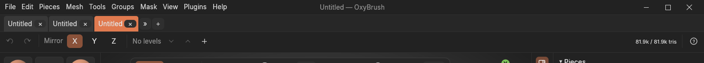

# RFC 0028: Unified title bar

Status: Accepted — phase 1 (Windows and Linux) implemented; phase 2 (macOS menu bar) next

## Summary

Make the top of the window one bar.

- **Windows and Linux:** the menus, the project name and the window
  buttons share one bar drawn by OxyBrush, in place of the system title
  bar and the menu row. The tabs stay in their row under it. The window
  moves, resizes, snaps and maximizes as before.
- **macOS:** the menus move to the macOS menu bar at the top of the screen,
  as in other Mac apps. The window keeps its system title bar, and the tabs
  sit right under it.

**Use system title bar** in Preferences brings back the current layout on
Windows and Linux.



## Why

Today the window has the system title bar (with only the project name in
it), then a row of menus, then the tab row. That's three bars before the
tools. With tabbed projects ([RFC 0027](0027-tabbed-projects.md)) the menus
and tabs belong to the window as a whole. Merging the title bar and the
menus:

- gives the model the height of a bar back;
- makes the menus and tabs look like part of the window rather than
  panels inside it;
- on Linux, replaces the stand-in title bar the window library draws under
  Wayland (GNOME), which doesn't match the system or OxyBrush;
- on macOS, puts the menus where Mac users look for them.

## What the user sees

### Windows and Linux

```text
File Edit Pieces … Help        dragon.oxb — OxyBrush         —  ☐  ✕
[• dragon ×][Untitled ×] » +
↶ ↷  Mirror X Y Z  No levels …
```

- **Menus** on the left, as today.
- **Project name** in the middle, dimmed, as the system title bar shows it
  now. It's left out when the window is too narrow, and stays the window's
  title for the taskbar, Alt+Tab and window lists.
- **Empty bar** around the name: drag it to move the window.
- **Minimize, maximize (or restore) and close** on the right, drawn by
  OxyBrush in the theme's colors. Close turns red on hover, as on Windows,
  and asks about unsaved tabs, as the system button does.
- **Tabs** in their own row under the bar, unchanged.

### macOS

```text
 OxyBrush  File Edit Pieces … Help          ← the macOS menu bar
● ● ●  dragon.oxb — OxyBrush                 ← the window's title bar
[• dragon ×][Untitled ×] +
↶ ↷  Mirror X Y Z  No levels …
```

- The menus are in the macOS menu bar, with the usual application menu
  (About, Settings, Hide, Quit) first, and their shortcuts shown there.
- The window's own title bar and buttons are the system's.
- The tab row is the first row in the window, with no menu row above it.

### On every platform

- **Drag** any empty part of the bar to move the window, including
  dragging to a screen edge to snap it (Windows, GNOME, KDE).
- **Double-click** an empty part to maximize or restore. On macOS the
  system title bar does this, following the system setting.
- **Right-click** an empty part for the system window menu where there is
  one (Windows, Wayland).
- **Resize** from the window edges and corners, as now.
- **Touch layout:** larger window buttons.
- **Preferences > General > Use system title bar** (off by default,
  Windows and Linux) goes back to the system title bar, with the menus and
  tabs in rows under it. It's for tiling window managers that prefer
  windows without their own title bar, or for anyone who likes the
  system's. It applies the next time OxyBrush starts.

## How it works

The window library (winit 0.30) has what's needed:

| Platform | Window | Moving | Resizing |
|---|---|---|---|
| Windows | `with_decorations(false)`, `with_undecorated_shadow(true)` | `drag_window` (system move, so Aero Snap works) | `drag_resize_window` from a 5-point edge: a window without decorations has no resize border of its own |
| Linux X11 | `with_decorations(false)` | `drag_window` (`_NET_WM_MOVERESIZE`) | `drag_resize_window` from the edges |
| Linux Wayland | `with_decorations(false)` (no stand-in title bar) | `drag_window` | `drag_resize_window` from the edges |
| macOS | unchanged | native | native |

- **Hit areas:** the menu bar has a background area that responds to
  presses and double-clicks, registered under the menus (as the
  Pieces rows do since #391), so a click on a menu still goes to it. A
  drag on the background calls `drag_window`. The title is painted, not a
  widget, so the bar under it is a drag area too. Menus and buttons never
  are.
- **Edges:** invisible areas 5 points wide along the window border, above
  everything else, show the resize cursor and start `drag_resize_window`
  in that direction. Presses there never reach the model, so they never
  start a stroke. They're off while the window is maximized.
- **After a move or resize** the system keeps the button release, so the
  app tells the interface the button went up; otherwise the next click
  would be missed.
- **macOS menu bar (phase 2):** a native menu built from the same menu
  definitions as the in-window menus, so each item is written once, with
  its enabled state and check marks kept in step each frame. The library
  for native menus must be pure Rust on macOS (for example `muda`, MIT or
  Apache-2.0, on `objc2`), used only in macOS builds. winit's own default
  menu is turned off.
- Nothing changes in projects or in the GPU-free crates; the only new
  setting is `system_title_bar`.

## Testing

- Editor tests drive the real interface: dragging the empty bar asks for
  a window move, a click on a menu doesn't; the tab row is under the bar;
  a double-click
  maximizes; each window button asks for its action; a press on an edge or
  corner resizes, but not while maximized; with the system title bar the
  bar is only menus. The preference is saved and read back.
- Linux under Xvfb with the openbox window manager: move, corner resize,
  double-click maximize and restore, minimize, close (and its unsaved
  changes prompt), and clicks still working after a move, checked with
  real pointer events.
- **By hand before it's called done:** Windows 11 (snap, maximize, resize,
  two monitors with different scales), GNOME on Wayland, and for phase 2
  macOS. These can't run in CI; each pull request says which were tried.

## Phases

1. **Windows and Linux:** the one bar with menus, project name and window
   buttons over the tab row, move, double-click, resize edges, the
   preference.
2. **macOS:** the menus in the macOS menu bar, from shared menu
   definitions; the tab row first in the window.

## Not included

- **Windows 11 Snap Layouts** on hover over the maximize button. That
  flyout only appears for a system-drawn button, which winit can't
  provide. Win+arrow keys and dragging to an edge still snap.
- **Tabs in the title bar** on any platform. The maintainer tried them in
  the Windows and Linux bar and chose to keep them in their own row.

## Decisions

The maintainer chose these on 2026-11-21:

- Windows and Linux use one bar for the menus, the project name and the
  window buttons, with the tabs in their own row under it (tabs in the bar
  were tried and turned down).
- macOS uses the macOS menu bar and keeps the system title bar, with the
  tabs under it.
- Linux always starts with OxyBrush's bar; **Use system title bar** turns
  it off, rather than guessing which window managers want it.
- The project name stays in the middle of the bar, and the window title.
