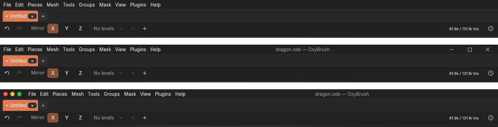

# RFC 0028: Unified title bar

Status: Draft

## Summary

Put the menus (File, Edit, Pieces, …) in the window's title bar, so the
top of the window is one bar instead of two. The window buttons go in the
same bar, and the tab row stays underneath it, as it is now. The window
moves, resizes, snaps and maximizes as before. **Use system title bar** in
Preferences brings back the current layout.



## Why

Today the window has the system title bar (with only "OxyBrush" in it),
then a row of menus, then the tab row. That's three bars before the tools.
With tabbed projects ([RFC 0027](0027-tabbed-projects.md)) the menus and
tabs belong to the window as a whole, and merging the title bar with the
menus:

- gives the model the height of a title bar back;
- makes the tabs look like part of the window rather than a panel inside
  it, as in browsers and code editors;
- on Linux, replaces the stand-in title bar the window library draws under
  Wayland (GNOME), which doesn't match the system or OxyBrush.

## What the user sees

### Windows and Linux

One bar at the top of the window:

```text
File Edit Pieces … Help        dragon.oxb — OxyBrush         —  ☐  ✕
[• dragon ×] [Untitled ×] [+]
```

- **Menus** on the left, as today.
- **Title** in the middle: the active tab's project name and "OxyBrush",
  dimmed, as the system title bar shows it now. It's left out when the
  window is too narrow.
- **Minimize, maximize (or restore) and close** on the right, drawn by
  OxyBrush in the theme's colors. Close turns red on hover, as on Windows.
  Close asks about unsaved tabs, as the system button does now.

### macOS

```text
● ● ●  File Edit Pieces … Help        dragon.oxb — OxyBrush
[• dragon ×] [Untitled ×] [+]
```

- The system's red, yellow and green buttons stay where they are, drawn
  by macOS. The title bar is transparent and the window's content extends
  under it, so the menus start just right of the buttons.
- The menus stay in the window for now, not in the macOS menu bar at the
  top of the screen. Moving them there is a separate, later step (see
  "Not included").

### On every platform

- **The tab row stays under the menu bar**, unchanged.
- **Drag** any empty part of the bar to move the window, including
  dragging to a screen edge to snap it (Windows, GNOME, KDE).
- **Double-click** an empty part to maximize or restore. On macOS this
  follows the system setting (zoom or minimize).
- **Right-click** an empty part for the system window menu where there is
  one (Windows, Wayland).
- **Resize** from the window edges and corners, as now.
- **Full screen** hides the window buttons.
- **Touch layout:** the bar is as tall as the Touch menus, with larger
  window buttons.
- **Preferences > General > Use system title bar** (off by default) goes
  back to the system title bar with the menus under it. It's for tiling
  window managers that prefer windows without their own title bar, or for
  anyone who just likes the system's. The change applies the next time
  OxyBrush starts, because macOS can't change it on an open window.

## How it works

The window library (winit 0.30) has what's needed:

| Platform | Window | Moving | Resizing |
|---|---|---|---|
| Windows | `with_decorations(false)`, `with_undecorated_shadow(true)` | `drag_window` (system move, so Aero Snap works) | the window's own borders; `drag_resize_window` from an 8-point edge if they don't respond |
| Linux X11 | `with_decorations(false)` | `drag_window` (`_NET_WM_MOVERESIZE`) | `drag_resize_window` from the edges |
| Linux Wayland | `with_decorations(false)` (no stand-in title bar) | `drag_window` | `drag_resize_window` from the edges |
| macOS | decorations kept; `with_titlebar_transparent`, `with_title_hidden`, `with_fullsize_content_view` | native (the title area) | native |

- **Hit areas:** the bar gets a background area that responds to presses
  and double-clicks, registered under the menu buttons and tabs (as the
  Pieces rows do since #391), so clicks on a menu still open it. A press on
  the background calls `drag_window`. Buttons and tabs are never drag
  areas.
- **Edges (Windows if needed, Linux):** the pointer within 8 points of the
  window edge shows the resize cursor and a press starts
  `drag_resize_window` in that direction. The editor ignores those presses,
  so they never start a stroke.
- **macOS:** the menus are offset by the width of the system buttons, read
  once at start, with a fixed fallback.
- **Title:** the same text the system title is set to today (it's still
  set, for the taskbar, Alt+Tab and window lists).
- Nothing changes in projects, settings files other than the new
  preference, or the GPU-free crates.

## Testing

- Editor tests: a press on the empty bar asks for a window drag, a press
  on a menu doesn't; a double-click toggles maximize; the preference is
  saved and read.
- Screenshots of every layout (Standard, Compact, Touch) and theme on
  Linux under Xvfb.
- **By hand, on real systems, before it's called done:** Windows 11
  (snap, maximize, resize, two monitors with different scales), macOS
  (button placement, full screen, Retina), GNOME on Wayland and KDE or
  another X11 desktop. These can't be run in CI; the pull request will
  say which were tried.

## Phases

1. **Windows and Linux:** the unified bar, drag, double-click, resize
   edges, window buttons, the preference.
2. **macOS:** transparent title bar with the menus beside the system
   buttons.
3. **Later, separately:** menus in the macOS menu bar.

## Not included

- **Tabs in the title bar** (as in browsers). The tabs stay on their own
  row under the menus, by the maintainer's choice.
- **The macOS menu bar** at the top of the screen. It would need a native
  menu library and every menu item wired up a second time; it's left for a
  later RFC.
- **Windows 11 Snap Layouts** on hover over the maximize button. That
  flyout only appears for a system-drawn button, which winit can't
  provide. Win+arrow keys and dragging to an edge still snap.

## Open questions

- Should Linux default to the system title bar on desktops where
  OxyBrush can tell the window manager is a tiling one, or always start
  with the unified bar?
- Should the project name stay in the middle of the bar, or should the
  tabs alone show it?
